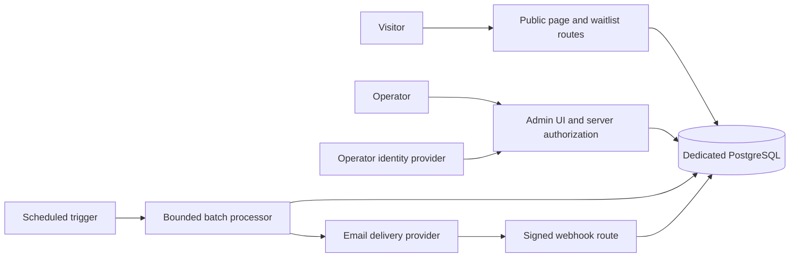

# Meduzellar Pre-Launch architecture

**Status** Proposed design for approved Size A and the isolated modular monolith direction



One application ships public pages, content, admin screens, API and a triggered processor. The database owns subscriber, campaign and job state. A scheduler wakes the processor. Provider callbacks report observed delivery events. Application modules own independent rules for waitlist, campaigns, queue and provider integration. The main Platform is outside this topology.

## Proposed repository structure

```text
meduzellar-pre-launch/
  AGENTS.md
  README.md
  docs/
    BRIEF.md
    TECH_CARD.md
    01-ARCHITECTURE.md
    … supporting specs and decisions
  src/
    app/                    Public, operator, and API route entry points
    components/             Brand, hero, accessible form and visual layers
    lib/
      waitlist/             Subscriber state, consent, token and delivery admission
      campaigns/            Immutable revisions, grants and approvals
      delivery/             Job leases, scheduling, retry and provider adapter
      security/             Identity, session checks, abuse and request policy
      db/                   Clients and bounded queries
    styles/                 Tokens and global baseline
  prisma/                   Schema and reviewed migrations
  public/                   Approved delivery assets
  tests/                    Component, DB integration and browser suites
```

Directories below docs are future implementation targets. The Module runtime uses strict server/client boundaries. Routes own content type, authentication, validation and HTTP mapping. Services own invariants and transactions. Prisma sits behind feature operations where transaction ownership is explicit. Use a mail adapter supporting send, classification and reconciliation. Keep env parsing server-only and provider-specific integrations at the boundary.

## Core flows

1. The public route renders the semantic landing page and immutable assets. The form posts to a same-origin API. Successful admission writes pending subscription, consent and verification work atomically.
2. The worker claims due rows, checks state, calls the provider with stable idempotency, then records acceptance. A later signed webhook can reconcile delivery. The verification landing route presents a confirmation control. The hash-checked POST activates and queues one confirmation.
3. An authorized operator previews and tests a frozen campaign revision. A fresh MFA owner confirms the revision and an upper bound on recipients. Bulk enqueue is asynchronous. A worker rechecks consent, suppression, approval and budgets before each dispatch.
4. Unsubscribe and deletion immediately block future handoffs. A restore or replay stays paused until suppression, deletion and uncertain provider outcomes are reconciled.

## Deployment and ownership

One region for compute and database, with the public static asset delivery distributed via CDN. Separate preview, staging and production projects and credentials. Preview never inherits production email or DB. Use a separate migration identity and checked expand-first releases. Database downtime fails the form with a retryable response. The public content remains available independently.

Main Platform launch is an external business decision. Production deployment and public URL cutover have separate gates from email release. Transition can keep unsubscription available on the existing origin while replacing the page, before rotating sender credentials and retiring data.

See [design](DESIGN.md), [data and contracts](WAITLIST.md), [worker and campaigns](EMAIL_OPERATIONS.md), [threat model](SECURITY_PRIVACY.md) and [deployment plan](DEPLOYMENT_AND_COSTS.md).
