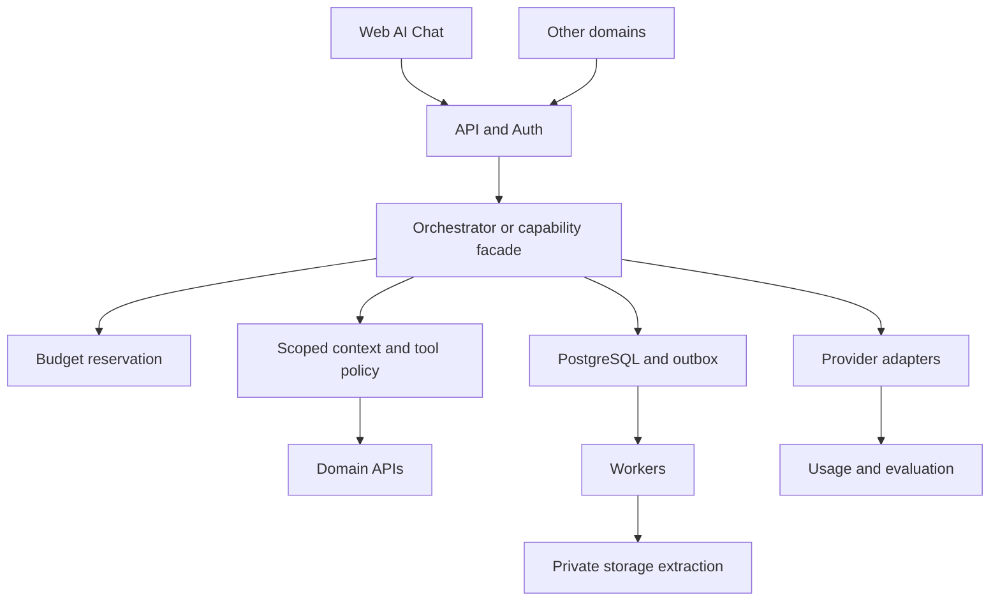

# MEDUZELLAR — CUSTOM AI MASTER ARCHITECTURE

**Version:** 1.0 | **Date:** 2026-11-25 | **Level:** Staff+ | **Phase:** A — Concept & Planning

**Կարգավիճակ.** Owner Approved — նախագծային ուղղություններ՝ սեփականատիրոջ ընդհանուր հաստատմամբ։ Այս փաստաթուղթը repository-ում դեռ չի ընդունվել։ Կոնկրետ մատակարարները, տարբերակները, գները, իրավական պայմանները, սահմանաչափերը և փորձարկման արդյունքները պայմանական են։ Նոր material deviation-ը պահանջում է առանձին հաստատում։ Համահարթակային Phase A sign-off և Phase B authorization չեն տրվել։

## 00. Ինչ ենք ստեղծում

Custom AI-ը Meduzellar-ի սեփական AI արտադրանքն ու ընդհանուր AI capability layer-ն է։ Այն սեփական մոդել զրոյից մարզելու նախագիծ չէ։ Սեփական են ինտերֆեյսը, orchestration-ը, տվյալների կանոնները, գործիքները, ծախսերի կառավարումը և մատակարարների adapter-ները։ Մոդելները սկզբում արտաքին ծառայություններ են։ AI Chat-ը և ընդհանուր inference service-ը տարբեր պատասխանատվություններ ունեն։ Messenger-ի թարգմանությունը չի պահանջում AI Chat subscription կամ AI conversation։

Օրինակ. մասնագետը հարցնում է «Գտիր ինձ React-ի համապատասխան աշխատանք»։ P0-ում AI-ն կարող է բացատրել որոնման քայլերը, իսկ P1-ում՝ թույլատրված Network search tool-ով իրական առաջարկներ բերել՝ հղումներով։ Չի դիմում աշխատանքի առանց օգտատիրոջ հստակ հաստատման։ Եթե տվյալ չկա, չի հորինում։

## 01. Product & Business Architecture

| Թեմա | Ընտրված ուղղություն |
|---|---|
| Արժեք | Մասնագիտական աշխատանքի համար AI՝ մեկ ընդհանուր հարթակում |
| Առաջին լսարան | Developers, Freelancers, փոքր Offices |
| Մյուս օգտատերեր | Հարթակի բոլոր օգտատերերը՝ իրենց իրավասության սահմաններում |
| Շուկա | Հայաստան՝ միջազգային օգտագործման պատրաստվածությամբ, ոչ հաստատված իրավական launch jurisdiction |
| Լեզուներ | Հայերեն, անգլերեն, ռուսերեն. որակը ստուգել յուրաքանչյուր լեզվով |
| Միջավայր | Responsive desktop/mobile web |
| Եկամուտ | Freemium + usage-based + B2B |
| Առաջին նպատակ | Օգտակար պատասխաններ՝ վերահսկելի գնով և անվտանգությամբ |

### 1.1 P0/P1/P2

| P0 | P1 | P2 |
|---|---|---|
| AI Chat, streaming, cancel/retry | Marketplace և Network read-only tools | Բազմաքայլ agents |
| History, rename, delete, regenerate | Messenger summaries, suggestions | Enterprise private deployments |
| Personal context, explicit Office context if shared contract ready | Office knowledge base և scoped RAG | Fine-tuning՝ միայն ապացուցված կարիքով |
| Սահմանափակ TXT/MD/PDF վերլուծություն՝ անվտանգ extraction | Opt-in personal memory | Private/self-hosted model feasibility |
| Basic code assistance՝ առանց execution | Confirmed low-risk write actions | Advanced automation |
| Usage metering, quota, provider adapter | Multi-provider quality routing | Collaborative AI workspaces |
| Shared translation capability contract | Career/Portfolio AI | Native code execution միայն մեկուսացված sandbox review-ից հետո |

P0-ը չի ներառում live web search, անսահմանափակ ֆայլեր, կամայական URL fetch, shell/code execution, autonomous purchases, job applications, զանգի ձայնագրություն կամ ամբողջ հարթակի տվյալների զանգվածային ingestion։ Translation/STT/TTS ընդհանուր ծառայությունների rollout-ը որոշվում է Messenger-ի հաստատված փուլերով. դրանք չեն տեղափոխում Messenger-ի P1 calls-ը P0։

### 1.2 Business Rules

| ID | Կանոն |
|---|---|
| AI-BR-01 | AI-ն միայն օգնում է, չի փոխարինում domain source of truth-ին։ |
| AI-BR-02 | User և Office գործողության principal-ը բացահայտ է, actor-ը audit-ում պահպանվում է։ |
| AI-BR-03 | Հարթակի հիմնական ֆունկցիաներն աշխատում են առանց AI-ի։ |
| AI-BR-04 | Մասնավոր տվյալները մշակվում են անհրաժեշտ նվազագույն չափով, հաստատված հիմքով և նպատակով։ |
| AI-BR-05 | Տվյալները չեն օգտագործվում մեր training-ի համար առանց առանձին opt-in. provider-ի պայմանները ստուգվում են։ |
| AI-BR-06 | Յուրաքանչյուր ծախսատար request նախ ստանում է budget reservation։ |
| AI-BR-07 | Free quota-ն սահմանափակ է, սպառվելու դեպքում սովորական հարթակը մնում է հասանելի։ |
| AI-BR-08 | AI-ն չի հաստատում payment, moderation, hiring կամ entitlement որոշում։ |
| AI-BR-09 | Գնման, հրապարակման և դիմումի գործողությունները պահանջում են explicit confirmation, domain authorization և idempotency։ |
| AI-BR-10 | Օգտատիրոջ ֆայլը, արտաքին փաստաթուղթը և tool output-ը անվստահելի տվյալ են, ոչ system instruction։ |
| AI-BR-11 | Private context-ը չի անցնում այլ tenant կամ ուրիշ զրույց առանց թույլտվության։ |
| AI-BR-12 | Գինը, մոդելը, հիշողությունը և retention-ը թափանցիկ են։ |
| AI-BR-13 | Չստուգված պատասխանները նշվում են, tool աղբյուրները հղվում են, հորինված citation չի թույլատրվում։ |
| AI-BR-14 | Նոր ֆունկցիաները բացվում են պահանջարկի, անվտանգության և տնտեսագիտության ապացույցներով։ |

## 02. Competitive Intelligence

Մրցակցային խմբեր՝ ընդհանուր AI assistants (ChatGPT, Claude, Gemini), coding assistants (GitHub Copilot և IDE agents), enterprise knowledge assistants, մասնագիտացված translation systems։ Սա կատեգորիաների համեմատություն է, ոչ նրանց ընթացիկ գների կամ ֆունկցիաների ստուգված audit։ Meduzellar-ի վարկածը՝ մեկ թույլատրված workflow-ը կապում է աշխատանք գտնելը, հաղորդակցությունը և թվային ապրանքի օգտագործումը։ Միայն chatbot UI-ն կայուն տարբերակում չէ։

Փորձարկում՝ 10–15 մասնագետի և 5 Office-ի հարցազրույց, նույն 20 աշխատանքային առաջադրանքի համեմատություն՝ ժամանակ, ճշտություն, օգտակարություն, լեզվական որակ, ծախս, գաղտնիություն։ Թվերը pilot planning assumptions են։ Մրցակիցների ընթացիկ պայմանները ստուգել պաշտոնական աղբյուրներով հետագա feasibility review-ում։

## 03. Domain Architecture

| Bounded context | Պատասխանատվություն |
|---|---|
| AI Conversations | Զրույցներ, branches, messages, user preferences |
| Inference Gateway | Provider routing, timeout, cancellation, normalized usage/errors |
| AI Orchestration | Run state, prompt policy, context construction, tool loop |
| Knowledge & Retrieval | File extraction, scoped retrieval, citations, հետագայում embeddings |
| Tool Governance | Tool registry, scopes, confirmation, execution audit |
| Usage & Budget | Reservations, usage, reconciliation, tenant/user limits |
| Evaluation & Safety | Versioned evaluation sets, moderation, regression, incidents |
| Shared AI Capabilities | Translation, STT/TTS և այլ domain-specific inference interfaces |

Shared Identity-ը տնօրինում է User/Organization/Membership-ը։ Payments-ը տնօրինում է ֆինանսական charge/credit արդյունքները։ Storage-ը տնօրինում է object primitives-ը։ Marketplace/Network/Messenger-ը տնօրինում են իրենց բիզնես տվյալները։ AI-ն չի կարդում մյուս մոդուլների DB աղյուսակները անմիջապես։

### 3.1 Logical data model

| Entity | Fields / constraints |
|---|---|
| AiConversation | id, ownerPrincipalId, actorCreatedBy, title, retentionPolicyId, status |
| AiMessage | id, conversationId, sequence, role, contentRef, parentMessageId, createdAt; unique conversation+sequence |
| AiRun | id, conversationId, inputMessageId, clientRequestId, status, modelPolicyVersion, deadline; unique principal+clientRequestId |
| ProviderAttempt | runId, attemptNo, provider/model alias, externalRequestId, status, usageEvidence; unique run+attemptNo |
| AiAttachment | ownerPrincipalId, conversationId, objectId, digest, scanStatus, extractionStatus |
| KnowledgeDocument / Chunk | ownerPrincipalId, ACL reference, version, sourceRef, retention; P1 embedding optional |
| ToolInvocation | runId, toolName, inputDigest, principal, scope, status, resultRef, idempotencyKey |
| ActionApproval | invocationId, actor, principal, immutable payload digest, expiresAt, consumedAt |
| UsageReservation | principal, requestId, cost ceiling, currency/unit, state, expiresAt |
| UsageRecord | reservationId, providerAttemptId, token/character/audio units, priceVersion, actualCost, evidence |
| BudgetPolicy | principal, capability, timeWindow, hardLimit, concurrencyLimit |
| PromptPolicyVersion | policy identifier, version, checksum, approved status |
| ConsentRecord / DeletionJob | subject, scope, version, timestamp; deletion lifecycle and evidence |
| OutboxEvent / AuditEvent | immutable event id, aggregate version, minimal redacted payload |

Physical schema, indexes, partitions and migration plan follow approved TECH_CARD. Monetary amounts use fixed precision/minor units as applicable, never floating-point ledger. Provider usage is not the user's financial invoice. No raw secrets in tables/logs. User-owned personal history remains personal; Office-owned conversation survives membership change but revoked actor loses access. Backup expiry is tracked, not advertised as immediate erasure.

### 3.2 State machines

- Run: CREATED → RESERVED → QUEUED/RUNNING → STREAMING → COMPLETED / FAILED / CANCELLED / UNKNOWN_USAGE. Reconciliation resolves unknown usage; partial output marked incomplete. Retry after visible output creates a new explicit run/branch, not concatenation of different providers.
- Reservation: RESERVED → SETTLED / RELEASED / RECONCILIATION_PENDING. Cancellation does not imply zero provider charges. Expired in-flight reservations cannot be blindly released.
- Attachment: UPLOADED → QUARANTINED → SCANNED → EXTRACTED → READY / REJECTED → DELETED. No extraction or provider submission before approval.
- Tool: PROPOSED → AUTHORIZED / CONFIRMATION_REQUIRED → APPROVED → EXECUTING → SUCCEEDED / FAILED / UNKNOWN. Expired or changed payload invalidates approval. Domain handles durable mutation idempotency.
- Deletion: REQUESTED → ACCESS_REVOKED → PURGE_PENDING → PURGED / LEGAL_HOLD (restricted and audited). Derived chunks, caches, files and provider-side deletion requests included where supported.

## 04. Functional Architecture

| ID | Requirement | Phase |
|---|---|---|
| AI-FR-01 | Create/list/rename own conversations | P0 |
| AI-FR-02 | Send message with idempotent request ID | P0 |
| AI-FR-03 | Stream ordered output, acknowledge terminal state | P0 |
| AI-FR-04 | Cancel run, stop delivery, reconcile usage | P0 |
| AI-FR-05 | Retry/regenerate as distinct run | P0 |
| AI-FR-06 | Paginated history and reconnect recovery | P0 |
| AI-FR-07 | Delete conversation and derived data lifecycle | P0 |
| AI-FR-08 | Upload allowed files with ownership and size checks | P0 |
| AI-FR-09 | Quarantine, safe extraction and bounded text context | P0 |
| AI-FR-10 | Language preferences and quality evaluation | P0 |
| AI-FR-11 | Estimate/reserve/settle usage atomically | P0 |
| AI-FR-12 | Free/premium entitlements and quota display | P0, paid only after payment gate |
| AI-FR-13 | Provider adapters and normalized errors | P0 |
| AI-FR-14 | Provider outage/circuit breaker and bounded retry | P0 |
| AI-FR-15 | Policy-based safety and redacted feedback | P0 |
| AI-FR-16 | Admin cost/quality/incident metrics without routine content access | P0 |
| AI-FR-17 | Shared translation contract, independent of AI chat | P0 capability per Messenger dependency |
| AI-FR-18 | Explicit principal context and resource access checks | P0 |
| AI-FR-19 | Marketplace and Network authorized search tools | P1 |
| AI-FR-20 | Messenger scoped summary/reply suggestion | P1 |
| AI-FR-21 | Office knowledge retrieval with citations and ACL | P1 |
| AI-FR-22 | Opt-in memory review/delete controls | P1 |
| AI-FR-23 | Confirmation-bound tool mutations | P1 controlled pilot |
| AI-FR-24 | Advanced agents, budgets, execution controls | P2 |

### 4.1 API draft (not final OpenAPI)

| Method/path | Contract |
|---|---|
| POST /api/v1/ai/conversations | authenticated actor + explicit principal; returns conversation ID |
| GET /api/v1/ai/conversations | scoped cursor pagination |
| PATCH /api/v1/ai/conversations/:id | rename only, authorization + optimistic version |
| DELETE /api/v1/ai/conversations/:id | 202 deletion job; immediate access revoke |
| GET /api/v1/ai/conversations/:id/messages | authorized paginated history |
| POST /api/v1/ai/conversations/:id/runs | clientRequestId, message, attachment IDs, capability; returns run ID/202 |
| GET /api/v1/ai/runs/:id | durable status and partial/final output |
| GET /api/v1/ai/runs/:id/events | authorized SSE stream, sequence cursor, bounded replay |
| POST /api/v1/ai/runs/:id/cancel | idempotent cancellation |
| POST /api/v1/ai/attachments | upload intent; private scoped grant |
| GET /api/v1/ai/usage | principal limits, measured usage, pending cost |
| POST /api/v1/ai/tool-invocations/:id/confirm | P1, digest-bound confirmation |

Internal capability interfaces: translate(text or authorized reference, source/target language, purpose, requester, request ID, budget scope); transcribe(audio reference, language, consent, deadline); synthesize(text, language, permitted voice, budget). Media capabilities follow Messenger phase. External APIs use standard error schema, 401/403/404 per privacy policy, 409 conflict, 429 quota, 503 unavailable. SSE authorization must be checked on reconnect and revocation; no bearer token in URL. Events: run.started, output.delta (ephemeral or bounded replay), run.completed, run.failed, usage.settled, attachment.ready, deletion.completed. Durable domain events use outbox, aggregate version and minimal payload; duplicate consumers idempotent.

## 05. UX & Customer Journey

Pages: AI Home, Chat with history sidebar, conversation, file upload, usage/billing, AI privacy settings, Office context selector, feedback. Responsive shared design system, keyboard and screen-reader navigation, accessible streaming status, contrast and RTL-ready layout. Main path: choose context → ask → see response streaming → stop/retry → inspect sources if retrieval → continue. Show model/capability, attachment scanning status, quota remaining, incomplete response, source access errors. Don't show hidden internal prompts or private reasoning. Before P1 action show exactly what changes and for whom; cancel option. No silent context switch or automatic ingestion of private chats. User can delete history; personal memory opt-in separate from history. Office admin sees usage totals by authorized scope, not all conversation content by default.

## 06. Trust, Security & Legal

Mandatory AGENTS.md invariants take precedence: CORS/CSRF, no unresolved Critical dependency exceptions, no unauthorized implementation. CSRF on applicable browser state-changing requests; service/webhook interfaces separately authenticated. TLS and encryption at rest, least privilege, MFA for admin, secrets manager, restricted egress, no sensitive log payloads. Model output never trusted as HTML or command; sanitize render. Provider credentials server-side only. No prompt includes secrets or unrelated private data.

| Threat | Control |
|---|---|
| Cross-tenant retrieval | Authorization before search, at retrieval, and before response/tool; ACL-aware index; re-check on revocation |
| Prompt injection | Treat files/tool outputs as data; allowlisted tools, typed schemas, independent policy checks, no unrestricted execution |
| Tool confused deputy | Actor+principal+resource authorization in target domain; short-lived scoped grants; no privilege inheritance from AI |
| Cost abuse | Atomic reservation, per-principal and global caps, concurrency and output limits, circuit breaker |
| Malicious file | Size/page/decompression limits, quarantine, isolated extractor, no macros/scripts/network access |
| SSRF/exfiltration | No arbitrary fetch in P0; allowlisted connector endpoints later, network restrictions |
| Streaming leakage | Session and ownership checks, revocation, bounded replay, no cross-run channel broadcast |
| Hallucination | Distinguish generated advice from verified source, cite tool results, abstain when no data |
| Recruitment bias | No automatic hire/reject; avoid sensitive traits and unjustified proxies; human review, evaluation and appeal |
| Data retention | Explicit policy by class, immediate access revoke, deletion jobs, backups age out, legal hold with oversight |
| Provider misuse | Contract review, region/retention/training settings, minimum necessary input; disable unapproved provider |

Authorization matrix (logical): guest none; User owns personal chat and files; Office member with AI permission can access explicitly assigned Office resources; Office billing manager sees scoped usage/billing; support sees operational metadata; security incident responder obtains time-limited approved access with audit; AI workers receive scoped job capability only. Every request and async tool execution rechecks membership. Admin access not blanket. Never imply E2EE when server or provider processes plaintext. Legal review: privacy notice, lawful basis, consent where necessary, cross-border processing, subprocessors, copyright/acceptable use, retention and deletion, billing/refund, minors and hiring requirements in actual launch jurisdictions. No claim of compliance before review.

## 07. Monetization & Unit Economics

Free tier: bounded chat and translation allocation, no forced payment for ordinary Marketplace/Network/Messenger functions. Professional tier: larger quota and later advanced tools. Office tier: shared allowance, seats/roles and usage dashboard. Additional usage only with explicit purchase/limit and shared Payments contract. No unlimited AI promises; no automatic surprise charge. Exact plans, prices, caps and countries remain experimental.

Cost formula per run: input tokens × input rate + output tokens × output rate + cached tokens × applicable rate + tools/embedding/storage/audio costs + retries + allocated operational overhead. Translation may be billed by characters/target language; audio by duration or tokens; use provider-specific versioned rate catalog. Keep separate units. Illustrative assumption only: 2,000 input tokens at $1/million and 500 output tokens at $4/million = $0.004 model cost; 100 such runs = $0.40 before overhead. Not vendor pricing or forecast. Avoid double counting cached units; store price effective date and usage evidence.

Preflight estimates worst allowed input/output and attempts, reserve atomically against user/Office/global budgets, stop when unavailable. On provider timeout keep reservation pending until reconciled; never assume no charge. Hard global kill switch disables new AI work but not core domains. Separate usage accounting (AI) from payment/ledger (Shared Payments). Track contribution margin after provider, storage, processing, support, payment fees and taxes. Paid launch gate requires positive viable unit economics under measured workload and validated payment/legal model.

## 08. Marketing & Growth

Message: «Մեկ AI՝ քո աշխատանքի, նախագծերի և մասնագիտական աճի համար»։ Առաջին օգտատերերը developers/freelancers, իսկ Offices՝ փոքր controlled pilot։ In-product discovery from Network/Marketplace with explicit context, demos in Armenian, community outreach, short onboarding with sample task. No automatic reading of other domains. North star candidate: weekly users completing a self-reported useful professional AI task, not message volume. Measure activation, 7/30-day retention, useful-answer feedback, task completion, cost per useful task, conversion and safety incidents. Pilot target proposal: 20–50 users, 3–5 Offices, 2–4 weeks; numeric go/no-go thresholds set before pilot, not claimed results. Expand only after demand, value, economics, technical, legal/security, operations and strategic fit gates pass.

## 09. Ecosystem Integration

| Domain | AI consumes/provides | Failure behavior |
|---|---|---|
| Marketplace | P1 public catalog / authorized purchases via scoped API; explain integration | Checkout, delivery and entitlements independent |
| Professional Network | P1 user-authorized profile/job search; CV suggestions | Applications and recruitment remain functional |
| Messenger | Shared translation capability; P1 explicit scoped summary; STT/TTS per call phase | Original message delivered, call continues where possible |
| Identity/Organizations | Actor/principal/membership, permission checks | Fail closed for protected access |
| Storage | Private upload, scan, extraction/deletion | File analysis unavailable, text chat continues |
| Payments | Verified plan/credit entitlements, billing results | No unverified paid grants; bounded existing entitlements per contract |
| Notifications | Minimal status event | Retry independently |

No cross-domain direct writes. Source domain verifies current visibility and authorization even when AI cached metadata exists. Tombstones/versioned events invalidate stale projections. User sees source links if available; no private source exposed to wrong principal. Messenger translation usage deduplication belongs to Messenger's message revision/target-language policy; shared AI records actual provider usage. One charge reservation per operation with domain attribution; avoid duplicate metering by AI Chat and Messenger.

## 10. Technical System Architecture

Candidates only pending platform TECH_CARD: TypeScript, Next.js/React, NestJS/Express, PostgreSQL/Prisma, Redis/BullMQ when workload justifies, S3-compatible storage, REST/OpenAPI, SSE for AI streaming, transactional outbox, Docker, OpenTelemetry, Jest/Playwright. Modular monolith + isolated workers; external inference behind adapters. No early Kubernetes/Kafka/vector DB or independent microservice per tool. pgvector or external vector search only after P1 retrieval evaluation and tenancy design. Shared stack version compatibility must be verified, not guessed.

### 10.1 Runtime sequence

1. Authenticate actor, resolve explicit principal, validate content and rate limits.
2. Persist user message, run and reservation in consistent transaction; use outbox for queued work.
3. Build bounded context: system policy, recent authorized history, approved attachments; truncate with visible limitations; no arbitrary platform-wide context.
4. Select capability/model based on validated language/quality/cost/availability and data-policy compatibility. Model aliases map to pinned provider configurations.
5. Stream output through backend; persist bounded partial/final output and status. On disconnect client can reconnect or fetch final state. Cancellation best effort upstream and mandatory local stop.
6. Settle actual usage from provider evidence; reconcile unknown outcome, release unused reservation. Emit redacted metrics and durable terminal event.

### 10.2 Provider architecture

Interface supports capability, model alias, normalized request/response, streaming, cancellation, usage, errors and provider request ID. Candidates include OpenAI, Anthropic, Google and specialized translation/speech providers; none selected. No assumption that model names, prices, language support or data retention terms are current. Evaluate official documentation and sandbox for Armenian/English/Russian, latency, output quality, API limits, billing, cancellation, data region, training/retention and availability in actual legal entity country. P0 one primary verified provider; optional fallback only if policy-compatible and within budget. Retry only transient failures with bounded backoff; do not blindly replay ambiguous billable requests. Fallback before visible output where safe. Shared translation can choose cheaper specialized adapter independently of chat provider.

### 10.3 Deployment and operations

Web/API plus worker process for extraction/async inference tasks; isolated file processing, no public object bucket; DB backups/PITR, restore drills, per-capability queue and concurrency limits. Redis optional for distributed coordination/queue; PostgreSQL durable source of truth. Queue is not billing authority. Separate dev/staging/prod credentials and quotas. Secret rotation, versioned prompt/model policy, canary evaluation, rollback to known compatible model configuration. Logs contain IDs/status/latency/usage, not raw prompt or file content by default.

## 11. Quality & Operational Architecture

Proposed targets, to be validated with workload and budget:

| ID | NFR |
|---|---|
| AI-NFR-01 | Chat API P95 acknowledgement ≤ 300 ms excluding inference |
| AI-NFR-02 | First token P95 ≤ 3 s for defined short prompt/model/network cohort |
| AI-NFR-03 | Core AI API monthly availability target 99.9%; provider-dependent capability SLO separately |
| AI-NFR-04 | Zero unauthorized cross-tenant access in acceptance tests |
| AI-NFR-05 | No duplicate logical run/reservation on repeated request |
| AI-NFR-06 | Hard local admission caps under concurrent requests; external usage reconciliation |
| AI-NFR-07 | RPO ≤ 1 hour, RTO ≤ 4 hours candidate, restore verified |
| AI-NFR-08 | Unresolved Critical dependency vulnerability blocks affected work; no exceptions |
| AI-NFR-09 | Deletion access revocation immediately on accepted operation; purge SLA set by policy/provider |
| AI-NFR-10 | Language and retrieval quality measured on versioned evaluation sets; thresholds agreed before release |

| ID | Acceptance test | Expected outcome |
|---|---|---|
| AI-AT-01 | Concurrent duplicate send | One logical run and reservation |
| AI-AT-02 | Disconnect during streaming | Reconnect or final fetch; no duplicate content |
| AI-AT-03 | Cancel mid-run | Stop local delivery, reconcile actual usage |
| AI-AT-04 | Provider timeout with unknown charge | Pending reconciliation, no blind retry |
| AI-AT-05 | Provider outage | Clear error, other domains unaffected |
| AI-AT-06 | Concurrent budget exhaustion | New run rejected before external call |
| AI-AT-07 | Cross-tenant conversation ID | Access denied |
| AI-AT-08 | Office membership revoked mid-stream | Stop protected stream and subsequent reads/tools |
| AI-AT-09 | Malicious archive/file | Quarantined/rejected, no model upload |
| AI-AT-10 | File prompt injection | No unauthorized tool or data disclosure |
| AI-AT-11 | Model returns unsafe HTML | Safe escaped/sanitized display |
| AI-AT-12 | Delete conversation | Access revoked, derived purge tracked |
| AI-AT-13 | Armenian/English/Russian tasks | Evaluated against human-reviewed reference |
| AI-AT-14 | Missing source | No fabricated citation, clear limitation |
| AI-AT-15 | Changed tool payload after confirmation | Rejected, new approval required (P1) |
| AI-AT-16 | Duplicate write invocation | Domain mutation at most once logically (P1) |
| AI-AT-17 | Stale retrieval after ACL change | Result excluded (P1) |
| AI-AT-18 | Translation provider down | Messenger original delivered |
| AI-AT-19 | Backup restore | RPO/RTO measured, access policy preserved |
| AI-AT-20 | CORS/CSRF, session and rate tests | Unauthorized actions blocked |

Testing: domain unit, real DB transaction/concurrency integration, adapter contract mocks and authorized sandbox, browser E2E, adversarial prompt and file corpus, human multilingual evaluation, load/cost tests, restore/incident drill. Operational owner for AI reliability, security/privacy, billing reconciliation and multilingual quality must be assigned. Alerts: error/timeout rate, first-token latency, queue age, cost velocity, unknown usage, denied tool attempts, deletion backlog. Runbooks: provider outage, cost spike, leaked credential, cross-tenant incident, unsafe outputs, deletion failure. Security incident response and model rollback separate from user feature rollout.

## 12. Delivery & Staff-Level Documentation

Project sizing recommendation: Custom AI initial scope B; long-term C; shared platform C candidate. One architecture, different delivery horizons. Actual team/workload/budget must inform final size. Vertical slices after platform approval; no application initialization yet.

| Work package | Deliverable / dependencies |
|---|---|
| AI-WP-01 | Read-only audit/import and decision alignment; Phase A |
| AI-WP-02 | Shared identity, data policy, contracts and provider feasibility; Phase A |
| AI-WP-03 | TECH_CARD/architecture/ADR + separate Phase B authorization |
| AI-WP-04 | Foundation + conversation CRUD/authorization (FR01,06,18; AT07,08) |
| AI-WP-05 | Durable run, streaming, cancellation (FR02–05; AT01–05) |
| AI-WP-06 | Budget, usage, reconciliation (FR11–12; AT06) |
| AI-WP-07 | Adapter + multilingual evaluation (FR10,13–14; AT13,18) |
| AI-WP-08 | Secure file handling and deletion (FR07–09; AT09–12) |
| AI-WP-09 | Safety, monitoring, restore, UX (FR15–16; AT14,19,20) |
| AI-WP-10 | Shared translation contract and controlled P0 pilot (FR17) |
| AI-WP-11 | P1 tools, retrieval, memory and confirmed actions (FR19–23; AT15–17) |
| AI-WP-12 | P2 evidence-driven expansion (FR24) |

ADR candidates: AI-ADR-01 gateway/provider adapter; 02 conversation and durable run; 03 budget reservation and reconciliation; 04 scoped context and tool authorization; 05 attachment isolation; 06 streaming transport; 07 privacy/deletion; 08 shared capabilities and domain ownership. Repository allocates official ADR IDs; these are domain candidate IDs, not global reservations.

### 12.1 Five Pre-Implementation Finalization packages

1. **Product:** §§01,04,05 scope and customer experience. P0 text-first chat, files, usage; P1 domain tools; P2 agents.
2. **Business & Financial:** §§07,08 metered free/premium/B2B, pilot cost validation, no approved production prices.
3. **Trust & Ecosystem:** §§03,06,09 security, shared boundaries, independent core domains.
4. **Technical:** §§03,04,10,11 logical schema, state machines, APIs, adapters, operations; physical model/version lock pending.
5. **Readiness:** §12 work packages, tests, ADR, handoff, gates; no authorization to build.

### 12.2 Decision register

All 16 directions below are Owner Approved for domain planning by the user's general authorization. Their technical details remain conditional wherever external or shared verification is required.

| ID | Direction | Condition |
|---|---|---|
| AI-DEC-001 | Professional ecosystem AI assistant | Demand validation |
| AI-DEC-002 | External models, own orchestration | Provider due diligence |
| AI-DEC-003 | Text-first P0, bounded file analysis | File security tests |
| AI-DEC-004 | Armenian/English/Russian | Human quality eval |
| AI-DEC-005 | Shared AI capability layer separate from chat | Shared contract |
| AI-DEC-006 | Explicit actor/principal authorization | Shared Identity ADR |
| AI-DEC-007 | Provider Adapter, policy-aware routing | Provider compatibility |
| AI-DEC-008 | Durable runs + streaming | Recovery tests |
| AI-DEC-009 | Freemium + usage-based + B2B | Price/payment/legal review |
| AI-DEC-010 | Atomic budgets and measured usage | Concurrency/reconciliation |
| AI-DEC-011 | Privacy-first and scoped retrieval | Policy/retention review |
| AI-DEC-012 | AI assists, domain owns decisions | Tool authorization |
| AI-DEC-013 | Modular Monolith + isolated workers | Platform TECH_CARD |
| AI-DEC-014 | Explicit action confirmation | P1 security review |
| AI-DEC-015 | Opt-in memory and no automatic training | Consent/provider contract |
| AI-DEC-016 | Evidence-Driven Expansion | Pilot gates |

### 12.3 Gates and blockers

| Gate | Evidence |
|---|---|
| G01 domain planning | Import, alignment audit, ADR sign-off, handoff |
| G02 shared platform | Identity, Payments, Storage, Notifications, AI ownership contracts |
| G03 Phase A platform | Approved scope, size, TECH_CARD, 01-ARCHITECTURE, backlog |
| G04 initialization | Separate explicit Phase B authorization |
| G05 provider/file feature | Approved provider agreement, language benchmark, secure extraction, budget caps |
| G06 paid feature | Legal/billing review, verified payment sandbox, usage reconciliation, tariff approval |
| G07 pilot | Security/quality/load/restore evidence, operational owners, measured cost, go/no-go |
| G08 expansion | Evidence-driven approval; P1/P2 threat review and rollout/rollback |

Open now: actual repository state; shared contracts; provider model versions and availability; language quality; real costs and pricing; legal jurisdictions and retention; max file/token/concurrency/time limits; team and operational owners; final physical DB/API/event schemas; infrastructure quotations; pilot metrics. These are not hidden approvals. No scaffold, dependency install, migrations, CI/CD, deployment or production spend in Phase A.

## Appendix A — Repository deliverables

Suggested docs/custom-ai/: this Master Architecture, GOVERNANCE_ALIGNMENT_NOTES_HY.md, CUSTOM_AI_PRE_IMPLEMENTATION_FINALIZATION_HY.md, official ADR-XXX-CUSTOM-AI-PLANNING-SIGN-OFF_HY.md, CUSTOM_AI_SHARED_PLATFORM_DEPENDENCY_HANDOFF_HY.md. Follow AGENTS.md and actual repository conventions. Preserve original hashes and historical status. Use accompanying CODEX_PROMPTS file in order. Domain sign-off does not close Platform Phase A.
