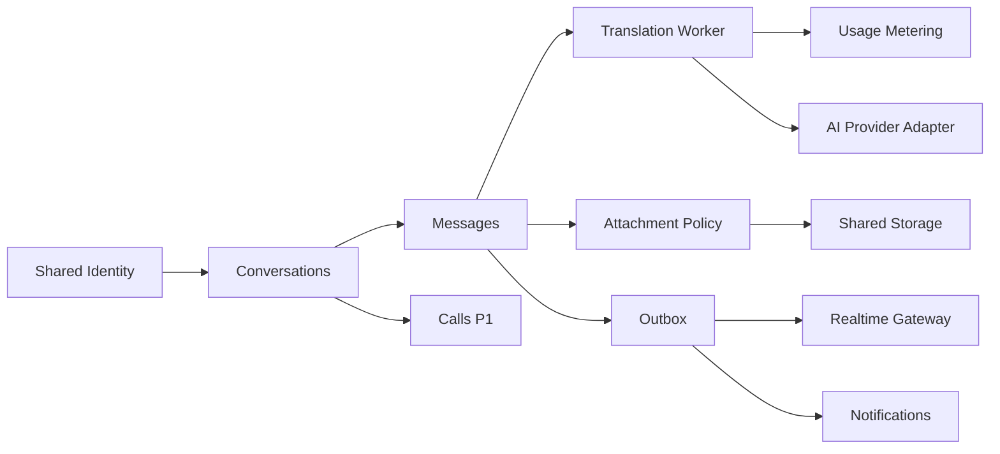
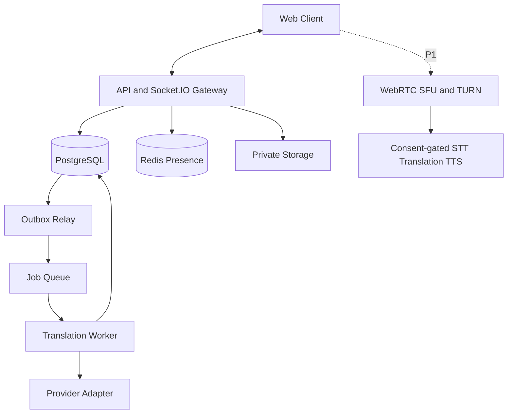

# Meduzellar — Custom Telegram + AI
## Master Architecture & Pre-Implementation Finalization v1.0

**Ամսաթիվ՝** 2026-11-25 | **Մակարդակ՝** Staff+ | **Ռազմավարություն՝** Evolution-Ready Architecture

**Կարգավիճակ՝** Owner Approved — Domain Planning (զրույցում տրված ընդհանուր հաստատմամբ)։ **Phase A՝ համահարթակային մակարդակում բաց։ Phase B՝ NOT AUTHORIZED։**

Այս փաստաթուղթը միավորում է բոլոր 12 ճարտարապետական ուղղությունները, 5 նախաիրականացման փաթեթները և CT-DEC-001–016 որոշումները։ Այն փոխարինում է Custom Telegram-ի նախկին ընդհանուր նախագծային առաջարկներին՝ որպես դոմենային պլանավորման հիմք։ Հաստատված է նախագծային ուղղությունը, ոչ թե չփորձարկված արդյունքը, մատակարարի պայմանագիրը, վերջնական սակագինը կամ համահարթակային TECH_CARD-ը։ Նոր մանրամասնեցումները ստորև նշված են որպես նախագծային defaults՝ հաստատված ուղղության շրջանակում, ոչ առանձին Owner-ի փաստացի որոշումներ։ Repository-ի համապատասխանությունը դեռ պետք է ստուգի Codex-ը։

## 0. Պարզ բացատրություն

Մենք ստեղծում ենք մեր սեփական Messenger-ը, ոչ Telegram-ի պատճենը կամ բոտը։ Հայ ծրագրավորողը գրում է հայերեն, ամերիկացի հաճախորդը կարդում է անգլերեն։ Հաճախորդը գրում է անգլերեն, ծրագրավորողը կարդում է հայերեն։ Հետագայում նույնը կատարվում է զանգերի ժամանակ՝ թարգմանված տեքստով, ապա ձայնով։ Մարդիկ կարող են գտնել աշխատանքի առաջարկներ մասնագիտական Channels-ում և շփվել Marketplace-ի գնորդների, վաճառողների ու գործատուների հետ։ Սովորական չատը անվճար է, լրացուցիչ AI օգտագործումը կարող է վճարովի լինել։

# Մաս I. Բոլոր 12 ճարտարապետական ուղղությունները

## 1. Product & Business Architecture

- **Արժեք՝** միջազգային մասնագիտական հաղորդակցություն առանց լեզվական խոչընդոտների նվազեցման համար լրացուցիչ գործիքների անհրաժեշտության։ Թարգմանությունը կարող է սխալվել և չի երաշխավորում կատարյալ հասկացվածություն։
- **Լսարան՝** developers, freelancers, գործատուներ, փոքր Offices, Marketplace-ի գնորդներ և վաճառողներ։ Սկզբնական վավերացում Հայաստանում, միջազգային ընդլայնում ըստ պատրաստվածության։
- **Հարթակ՝** responsive Desktop/Mobile Web, սկզբում հայերեն/անգլերեն/ռուսերեն թարգմանության թիրախներով։ UI լեզուները հայերեն և անգլերեն՝ նախագծային default։
- **Հիմնական սկզբունք՝** մեկ մարդու identity, անձնական և լիազորված Office contexts՝ shared platform-ի վերջնական պայմանագրով։
- **Հաջողություն՝** մասնակիցները վերադառնում են իրական երկկողմանի աշխատանքային հաղորդակցության համար, ոչ միայն գրանցվում են։

| ID | Բիզնես կանոն |
|---|---|
| CT-BR-01 | Սովորական հաղորդակցությունը չի կախված AI-ից կամ վճարովի AI քվոտայից։ |
| CT-BR-02 | Բնօրինակը չի փոխարինվում թարգմանությամբ։ |
| CT-BR-03 | Թարգմանությունը կատարվում է միայն թույլատրված զրույցի, լեզվի և տվյալների մշակման շրջանակում։ |
| CT-BR-04 | Նույն revision-ի նույն լեզվով թարգմանությունը կրկնակի չի ստեղծվում առանց հիմնավորված անհրաժեշտության։ |
| CT-BR-05 | P1 զանգում առավելագույնը 5 մասնակից՝ ներառյալ հրավիրողը։ |
| CT-BR-06 | Անձնական և Office տվյալներն ու AI օգտագործման հաշվառումը տարանջատվում են։ |
| CT-BR-07 | Marketplace-ի պատվերները և Network-ի դիմումները պատկանում են իրենց դոմեններին։ |
| CT-BR-08 | Անվտանգության հիմնական գործառույթները վճարովի չեն։ |
| CT-BR-09 | Channels-ի հրապարակումը opt-in է, իրավասու աղբյուրից, վերջնական shared quota պայմանագրով։ |
| CT-BR-10 | Ձայնագրումը լռելյայն անջատված է, պահպանվող transcript-ը պահանջում է համապատասխան թույլտվություն։ |
| CT-BR-11 | Ոչ մի AI պատասխան ինքնուրույն չի ուղարկվում մարդու անունից։ |
| CT-BR-12 | Նոր գործառույթները գործարկվում են միայն արժեքի, ֆինանսական, տեխնիկական, անվտանգության և գործառնական պատրաստվածության ապացույցներով։ |

## 2. Competitive Intelligence

| Համեմատման ուղղություն | Մրցակիցների օրինակներ | Մեր վարկածը |
|---|---|---|
| Անձնական հաղորդակցություն | Telegram, WhatsApp | Թարգմանությունը և աշխատանքային context-ը մեկ տեղում |
| Թիմային աշխատանք | Slack, Teams | Փոքր միջազգային թիմերի համար պարզ մուտք |
| Համայնքներ | Discord, Telegram | Աշխատանքների և ապրանքների մասնագիտական Channels |
| Զանգեր | Zoom, Teams | Հայերենով հասանելի թարգմանված transcript |
| Թարգմանություն | DeepL, Google Translate | Առանձին պատուհան չբացելով հաղորդակցություն |

Սա մրցակցային հետազոտության շրջանակ է, ոչ ստուգված feature-by-feature համեմատություն։ Չենք պնդում, որ մրցակիցները չունեն թարգմանություն։ Pilot-ից առաջ չափել թարգմանության ճշտությունը, գործնական հասկանալիությունը, ծախսը և հաճախորդների՝ այլ գործիքից անցնելու պատրաստակամությունը։ Առաջին փորձարկման առաջարկ՝ 10–20 միջազգային շփում ունեցող մասնագետ և 3–5 Office, ոչ շուկայական ապացույց։

## 3. Domain Architecture

| Մոդուլ | Տվյալների պատասխանատվություն |
|---|---|
| Conversations | Conversation, ConversationMember, context, անդամության և հաղորդակցման քաղաքականություն |
| Messages | Message, MessageRevision, sequence, receipts, tombstones |
| Translation | MessageTranslation, language, model/policy version, processing state |
| Attachments | Attachment metadata, scan state, access decision; bytes-ը shared storage-ում |
| Presence | Ժամանակավոր online/typing տվյալներ՝ privacy policy-ով |
| Safety | BlockRelation, Report, ModerationAction |
| Usage | UsageRecord, reservation, entitlement/limit reference, reconciliation |
| Channels (P1) | Channel, Subscription, ChannelPost, projection version |
| Calls (P1) | CallSession, CallParticipant, TranscriptSegment, consent state |
| Chat AI (P1+) | AIRequest, թույլատրված context references, արդյունքի վիճակ |

Տվյալների բազան հեղինակավոր աղբյուր է. Socket.IO-ն, Redis-ը և search projection-ը չեն փոխարինում դրան։ Shared Identity-ն տնօրինում է մարդկային ինքնությունը և Office membership-ը, Messenger-ը՝ conversation membership-ը։ Դոմենների միջև ուղղակի table writes չեն թույլատրվում։

### 3.1 Logical data model

| Entity | Հիմնական դաշտեր / constraints |
|---|---|
| Conversation | id, type, contextPrincipalId, nextSequence, policyVersion, status |
| ConversationMember | conversationId, actor/principal reference, role, joinedAt, leftAt, lastReadSequence; unique membership key |
| Message | id, conversationId, senderActorId, senderPrincipalId, clientMessageId, sequence, currentRevision, status; unique sender/conversation/clientMessageId և conversation/sequence |
| MessageRevision | messageId, revision, originalText, createdAt; unique message/revision |
| MessageTranslation | messageId, revision, targetLocale, policyVersion, status, text; unique processing key, no cross-conversation content cache |
| MessageReceipt | memberId, deliveredSequence, readSequence; monotonically increasing |
| Attachment | id, owner/context, objectKey, digest, size, mediaType, scanStatus |
| BlockRelation / Report | actor, target/resource, reason, status, timestamps |
| UsageRecord | operationId, payerPrincipal, feature, units, state, providerRef; unique operation key |
| OutboxEvent | eventId, type, aggregateId, version, payloadRef, status, retryAt |
| Channel / ChannelPost | audience, sourceType/sourceId, sourceVersion, visibility, publication reference |
| CallSession / CallParticipant | roomId, conversationId, state, participants, consent version, join/leave timestamps |
| TranscriptSegment | callId, speakerId, segmentId, revision, locale, state, retention class |

Սա logical model է. SQL schema, indexes, migrations և physical partitioning դեռ չեն ստեղծվում։

### 3.2 State machines

- Message: local pending → committed → visible; edit ստեղծում է նոր revision; delete → tombstone։ Delivery/read-ը առանձին member cursor է, ոչ global message status։
- Translation: queued → processing → ready / retryable failed / terminal failed / skipped; deletion կամ նոր revision → obsolete։
- Attachment: upload authorized → quarantine → scanning → clean / rejected / expired; clean-ից հետո միայն authorized delivery։
- Call: initiated → ringing → active → ended; այլ ելքեր՝ declined, cancelled, timeout, failed։ Մասնակիցների թիվը ստուգվում է server-side atomic admission-ով։
- Usage: reserved → consumed / released / uncertain → reconciled։ Timeout-ը ինքնաբերաբար չի նշանակում անվճար provider call։

## 4. Functional Architecture

| ID | Փուլ | Պահանջ |
|---|---|---|
| CT-FR-01 | P0 | 1:1 զրույց ստեղծել ըստ message request/block կանոնների։ |
| CT-FR-02 | P0 | Ուղարկել բնօրինակը, durable acknowledgment ստանալ commit-ից հետո։ |
| CT-FR-03 | P0 | Reconnect-ից հետո cursor-ով ստանալ բաց թողնված հաղորդագրությունները։ |
| CT-FR-04 | P0 | Reply, edit, delete՝ իրավասության ստուգմամբ և revision/tombstone semantics-ով։ |
| CT-FR-05 | P0 | Delivered/read status, privacy settings։ |
| CT-FR-06 | P0 | Թարգմանել թույլատրված revision-ը նախընտրած լեզվով, տեսնել բնօրինակը։ |
| CT-FR-07 | P0 | Անվտանգ ֆայլեր՝ quarantine և scan-ից հետո։ |
| CT-FR-08 | P0 | Որոնում միայն հասանելի զրույցներում։ |
| CT-FR-09 | P0 | Ծանուցումներ՝ նվազագույն տվյալներով, mute/settings։ |
| CT-FR-10 | P0 | Block, report, spam protection։ |
| CT-FR-11 | P0 | Marketplace/Network-ից authorized chat handoff։ |
| CT-FR-12 | P0 | AI օգտագործման չափում, quota և ծախսային սահմաններ։ |
| CT-FR-13 | P1 | Groups, անդամների դերեր և history visibility policy։ |
| CT-FR-14 | P1 | Smart Channels, opt-in հրապարակում, subscription և moderation։ |
| CT-FR-15 | P1 | Voice messages, թույլատրված transcription։ |
| CT-FR-16 | P1 | Voice/video calls՝ մինչև 5 մասնակից։ |
| CT-FR-17 | P1 | Streaming STT → translation → live transcript, ապա TTS pilot։ |
| CT-FR-18 | P1 | AI summary և suggested replies՝ user-triggered, առանց auto-send-ի։ |
| CT-FR-19 | P2 | Meeting assistant, task extraction, Office workspace և enterprise controls։ |
| CT-FR-20 | P2 | AI channel intelligence, custom agents և workflow automation։ |

### 4.1 Reliable messaging protocol

Client-ը ստեղծում է clientMessageId։ Backend-ը ստուգում է session, context, conversation membership, block և rate limit, ապա մեկ transaction-ում պահում է Message, sequence, OutboxEvent։ Միայն commit-ից հետո ուղարկվում է acknowledgment։ Retry-ը վերադարձնում է նույն committed արդյունքը, իսկ նույն key-ով տարբեր payload-ը մերժվում է։ Outbox relay-ը at-least-once է, consumer-ը idempotent։ Client-ը dedupe է անում ID-ով և gap-ի դեպքում sync անում sequence cursor-ով։ Realtime gateway-ի խափանումը չի ջնջում committed message-ը։ Edit/delete-ը optimistic concurrency-ով են՝ expected revision։ Delete-ը UI-ից անմիջապես թաքցնում է համապատասխան content-ը, physical purge-ը ըստ retention/legal hold policy-ի։

### 4.2 Translation protocol

Բնօրինակը ուղարկվում է անմիջապես։ Translation worker-ը ստուգում է consent/authorization, լեզուն, revision-ը և quota reservation-ը, ապա provider-ին ուղարկում է նվազագույն անհրաժեշտ տեքստը։ Արդյունքը պահելուց և փոխանցելուց առաջ նորից ստուգում է revision, deletion և access policy։ Նույն լեզվի դեպքում skip։ Խափանման դեպքում բնօրինակը մնում է տեսանելի, bounded retry և manual retry՝ սահմանաչափով։ Group-ում նույն թույլատրված լեզվի արդյունքը բաժանվում է միայն նույն զրույցի իրավասու մասնակիցներին։ Code blocks, URLs, թվեր և տեխնիկական տերմիններ չպետք է լուռ աղավաղվեն. UI-ն նշում է մեքենայական թարգմանություն։

## 5. UX & Customer Journey

| Էջ | Գործողություն |
|---|---|
| Chats | Զրույցների ցանկ, unread, search, requests |
| Personal Chat | Բնօրինակ/թարգմանություն, reply/edit/delete, attachments |
| Settings | Լեզու, թարգմանության ընտրություն, privacy, block, AI quota |
| Groups / Channels (P1) | Անդամություն, subscription, publishing, moderation |
| Calls / Call Room (P1) | Device permissions, call controls, consent, live transcript, լեզու |
| Office Context | Context switch, լիազորված զրույցներ, ընդհանուր քվոտա |
| Admin | Report queue, abuse controls, usage/incident monitoring՝ սահմանափակ իրավունքներով |

UX states՝ sending, sent, delivered, read, offline, failed/retry, translation pending/failed/skipped, quota exhausted, file quarantined/rejected։ Թարգմանությունը չի թաքցնում բնօրինակը. թարգմանության անհասանելիությունը չի արգելակում input-ը։ White/Blue, Light/Dark, responsive, keyboard navigation, screen-reader labels և WCAG 2.2 AA նախագծային թիրախ։

## 6. Trust, Security & Legal

**P0՝ Encrypted Cloud Chat** (TLS և encryption at rest, ոչ E2EE)։ Առանձին Secure Chat/E2EE ռեժիմը հետագա նախագծում է. server-side AI-ը չի կարող ստանալ E2EE բովանդակություն առանց համապատասխան բացահայտման/endpoint մշակման։ Չենք խոստանում end-to-end պաշտպանություն ներկայիս cloud chat-ի համար։

| Ռիսկ | Պաշտպանություն |
|---|---|
| Cross-tenant / unauthorized access | Deny-by-default, յուրաքանչյուր REST/WS գործողության resource authorization, membership revocation և socket invalidation |
| Session theft | Shared auth, session expiry/revocation, MFA admin-ի համար |
| Browser attacks | Mandatory CORS allowlist և CSRF պաշտպանություն կիրառելի browser mutation-ների համար, WS Origin ստուգում, validation |
| Spam / abuse | Message requests, block/report, rate limits, moderation audit |
| Malicious attachments | Allowlist, size limit, MIME/signature validation, archive risk controls, private quarantine, scan fail-closed, short-lived access |
| AI data leakage | Consent/policy gate, minimum context, no private chat training առանց համապատասխան համաձայնության, provider data terms review |
| Prompt injection | Chat text-ը untrusted data է, AI-ն չի ստանում ինքնուրույն գործարք/հրապարակում/ուղարկում կատարելու իրավունք |
| Cost abuse | Atomic quota reservation, per-principal limits, provider spend caps, kill switch |
| Admin misuse | Least privilege, scoped case access, audit, secrets/PII redaction |
| Critical dependencies | Չլուծված Critical vulnerability-ն կանգնեցնում է ազդված աշխատանքը. բացառություն չկա |

### 6.1 Privacy և retention

Նախապես պարզ բացատրել՝ երբ է սերվերը կամ provider-ը մշակում հաղորդագրությունը/ձայնը։ Conversation-level policy և participant preferences չեն շրջանցվում մյուս մասնակցի խնդրանքով։ Զանգի նոր մասնակիցը translation stream չի մտնում մինչև consent-ի պայմանների բավարարումը։ Ձայնագրումը default off, live transcript-ը ժամանակավոր է, մշտական պահպանումը միայն թույլտվությամբ։ Delete/export/account deletion, backup expiry, legal hold և provider deletion պայմանները պետք է իրավաբանորեն ու տեխնիկապես հաստատել մինչև release։ Logs-ում message body, transcript, access token կամ ֆայլի signed URL չեն պահվում։ Exact retention ժամկետները բաց արտաքին/իրավական gate են։

### 6.2 Authorization matrix (նախագծային)

| Գործողություն | Անձնական մասնակից | Office-ի լիազորված անդամ | Այլ անձ | Admin |
|---|---|---|---|---|
| Read/send | Միայն սեփական զրույց | Միայն թույլատրված Office conversation | Ոչ | Ոչ լռելյայն |
| Edit/delete | Սեփական message ըստ policy | Սեփական message ըստ policy | Ոչ | Միայն moderation action ըստ case |
| Download | Member + clean attachment | Membership + member + clean | Ոչ | Scoped case, audit |
| Translate / AI | Policy + consent + quota | Նույնը + Office permission | Ոչ | Ոչ լռելյայն |
| Report | Իրավասու resource | Իրավասու resource | Միայն թույլատրված հանրային report | Scoped review |

## 7. Monetization & Unit Economics

Սովորական chat-ը անվճար է։ AI text translation՝ սահմանափակ free quota + paid usage, ֆայլեր՝ storage limits, calls՝ սահմանափակ free usage և վճարովի translation։ Professional AI tools և Office subscription, հետագայում հստակ նշված sponsored channel posts։ $4.99 Professional և $19.99 Office ամսական գները հաստատված **փորձարարական վարկածներ** են, ոչ production tariffs։ Անվճար քվոտաները որոշվում են իրական unit economics-ից հետո։

**Ծախսի օրինակ (ոչ գնացուցակ).** 1000 ակտիվ թարգմանող օգտատեր × 30 հաղորդագրություն/օր × 80 նիշ × 30 օր = 72 մլն նիշ մեկ թիրախային լեզվով։ Պայմանական $20/մլն նիշ դեպքում $1440/ամիս, $5 դեպքում $360։ Չի ներառում STT/TTS, context tokens, retry, storage, egress, tax, support։ Զանգի ծախս = participant media minutes + STT audio minutes + translation units ըստ թիրախային լեզվի + TTS units + egress։ Մարժա = եկամուտ − provider fees − infrastructure allocated cost − support/refunds/taxes ըստ հաստատված հաշվապահական մոդելի։

Quota սպառվելիս chat-ը մնում է անվճար և աշխատող։ AI job-ից առաջ reserve, հետո իրական օգտագործման reconcile, duplicate operation-ը երկրորդ անգամ չի գանձվում։ Ոչ մի ավտոմատ overage վճար առանց հստակ համաձայնության։ Provider outage կամ spending cap-ի դեպքում AI circuit breaker։

## 8. Marketing & Growth

Դիրքավորում՝ **Speak your language. Work with the world.** Սկզբում ձեռք բերել օգտատերեր Marketplace/Network handoff-ով, freelancer համայնքներից և փոքր Offices-ի փորձնական ծրագրերից։ Չափել activation՝ առաջին երկկողմանի զրույցը և օգտակար թարգմանությունը, retention՝ կրկնվող շաբաթական աշխատանքային զրույց, cost per active translator, paid conversion, translation success/latency, abuse rate։ North star թեկնածու՝ շաբաթական ակտիվ մասնագիտական երկկողմանի զրույցներ։ Չափումները չպետք է պահանջեն private message body-ի analytics։ Pilot go/no-go թվերը հաստատել փաստացի տվյալներով և բյուջեով, ոչ հորինված demand-ով։

## 9. Ecosystem Integration

| Shared contract | Պատասխանատու / outage վարք |
|---|---|
| Identity / Organizations | Shared domain՝ actor/principal/membership; revocation-ը մերժում է հաջորդ protected request-ը |
| Marketplace | Գնումների և support case-ի սեփականատեր. authorized chat handoff, commerce-ը շարունակում է առանց Messenger-ի |
| Professional Network | Job/application/profile-ի սեփականատեր. authorized conversation handoff |
| Custom AI | Provider/model policy և AI tooling-ի shared contract; outage → original chat |
| Storage | Private bytes, scan primitives; Messenger-ը որոշում է download իրավասությունը |
| Payments | Shared billing/financial records; Messenger-ը usage entitlement և quota կիրառող է |
| Notifications | Minimal event delivery; outage չի կանգնեցնում message commit-ը |
| Channels | Opt-in source projection, versioned visibility/tombstone; quota owner-ը shared review-ում |

Event envelope՝ eventId, type, schemaVersion, aggregateId, aggregateVersion, occurredAt, correlationId, minimal payload/reference։ Out-of-order events չեն վերականգնում deleted/unlisted resource-ը։ AI retrieval-ը նորից ստուգում է source-level permission-ը։ Channel quota-ի նախկին User 3–5/Office 1 թվերը այստեղ չեն հաստատվում որպես shared policy։

## 10. Technical System Architecture

| Շերտ | Հաստատված նախագծային թեկնածու |
|---|---|
| Topology | Modular Monolith + isolated workers; media plane առանձին P1-ում |
| Language / Web | TypeScript, Next.js, React |
| API | NestJS, Express, REST/OpenAPI |
| Realtime | Socket.IO; durable sync-ը application protocol-ով |
| Data | PostgreSQL, Prisma |
| Presence / Jobs | Redis, BullMQ; durable outbox և idempotent workers |
| Search | PostgreSQL search առաջին փուլում, Armenian search quality benchmark |
| Files | S3-compatible private object storage |
| Calls | WebRTC / SFU, LiveKit թեկնածու, TURN |
| AI | Replaceable provider adapters՝ text translation, STT, TTS, LLM |
| Operations | Docker, OpenTelemetry, Jest, Playwright |

Exact versions, peer compatibility, deployment vendor, regions, Redis/BullMQ-ի shared sizing-ը Platform TECH_CARD-ի մաս են։ Չենք կառուցում սեփական SFU, Kafka/Kubernetes կամ վաղաժամ microservices։ Translation providers՝ Google Cloud Translation/Azure Translator; STT/TTS՝ Google/Azure/OpenAI՝ ուսումնասիրության թեկնածուներ, ոչ հայերենի բոլոր ռեժիմների հաստատված աջակցություն։

### 10.1 API draft

| Method / path | Semantics |
|---|---|
| POST /api/v1/conversations | Authorized create/get, idempotent request |
| GET /api/v1/conversations | Cursor pagination, membership filter |
| GET /api/v1/conversations/:id/messages | Cursor sync/history; permission recheck |
| POST /api/v1/conversations/:id/messages | clientMessageId, text/attachmentRefs/replyTo, durable ack |
| PATCH /api/v1/messages/:id | expectedRevision, edit permission |
| DELETE /api/v1/messages/:id | authorized tombstone, idempotent |
| POST /api/v1/messages/:id/translations | revision/locale, policy and quota |
| POST /api/v1/attachments | Upload authorization and quarantine |
| GET /api/v1/attachments/:id/download | Clean state, membership, short-lived credential |
| PATCH /api/v1/preferences | Language/privacy settings |
| POST /api/v1/reports | Abuse report, rate limit |
| GET /api/v1/usage | Authorized quota/usage summary |
| /api/v1/channels; /api/v1/calls | P1 contracts՝ առանձին review |

WebSocket events՝ message.created/updated/deleted, translation.ready/failed, receipt.updated, presence.changed, call.started/ended (P1)։ WS commands-ը նույն validation/authorization service-ով են անցնում, ինչ REST-ը։ Errors՝ stable code, correlationId, no sensitive content; 401/403/404 ըստ disclosure policy, 409 revision/idempotency conflict, 429 quota/rate limit։ OpenAPI և event schemas վերջնականացվում են approved architecture-ում։

### 10.2 Calls / live translation (P1)

WebRTC media → SFU → consent-gated per-speaker audio stream → streaming STT → language translation → transcript event → optional TTS per target language։ Call admission-ը առավելագույնը 5 մասնակից է. reconnect-ը նույն մասնակցին երկրորդ տեղ չի տալիս։ Partial/final transcript segments ունեն speaker, sequence և revision, UI-ն final-ը չի կրկնում։ TTS-ը synthetic voice է, ոչ voice cloning, original audio-ն հնարավոր է լսել։ Translation failure → normal call, media failure → reconnect/clear end state։ TURN, mobile permissions, echo/feedback, speaker overlap, bandwidth adaptation, transcript lag և հայերեն STT/TTS benchmark պարտադիր։ No default recording։

## 11. Quality & Operational Architecture

| ID | Նախնական չափելի թիրախ / invariant |
|---|---|
| CT-NFR-01 | Message commit acknowledgment P95 ≤ 300 ms սահմանված pilot region/load-ում |
| CT-NFR-02 | Online delivery P95 ≤ 500 ms նույն test profile-ում |
| CT-NFR-03 | Short translation P95 ≤ 2 վրկ՝ ընտրված լեզուներով, provider latency-ն առանձին չափելով |
| CT-NFR-04 | Live final translated segment P95 ≤ 3 վրկ segment boundary-ից (P1) |
| CT-NFR-05 | 0 duplicate logical messages հաստատված idempotency test-ում |
| CT-NFR-06 | Monthly core availability target 99.9%, AI availability առանձին |
| CT-NFR-07 | RPO ≤ 15 րոպե, RTO ≤ 2 ժամ՝ restore drill-ով ստուգվող |
| CT-NFR-08 | 0 known unresolved Critical vulnerabilities ազդված աշխատանքում |
| CT-NFR-09 | Unauthorized access test-երում 0 հաջող bypass |
| CT-NFR-10 | AI outage/spend cap-ը չի կանգնեցնում message commit-ը |

Load profile, devices, payload size, concurrency և region-ը նախապես փաստագրել benchmark-ից առաջ։ Սրանք թիրախներ են, ոչ չափված երաշխիքներ։ RPO-ն նշանակում է աղետի դեպքում հնարավոր տվյալների կորստի պատուհան, ոչ բացարձակ zero loss։ Monitoring՝ message commit failures, outbox lag, reconnect gaps, translation backlog/latency, quota mismatch, scan backlog, WS connections, call packet loss/jitter, provider spend։ Runbooks՝ DB restore, AI outage, queue replay, credential leak, abuse incident, storage block, media outage։ Assign owner և escalation մինչև pilot։

| ID | Acceptance test |
|---|---|
| CT-AT-01 | Duplicate send նույն key-ով → մեկ message, նույն acknowledgment |
| CT-AT-02 | Commit-ից հետո network drop → reconnect sync, gap recovery |
| CT-AT-03 | Concurrent send → unique sequence, client ordering |
| CT-AT-04 | AI timeout → original visible, bounded retry |
| CT-AT-05 | Edit/delete during translation → stale result չի ցուցադրվում |
| CT-AT-06 | Non-member REST/WS/search/download → deny |
| CT-AT-07 | Office membership revoke → protected access denied, socket invalidated |
| CT-AT-08 | Blocked user → նոր direct communication ըստ policy մերժված |
| CT-AT-09 | Malicious file / scan error → ոչ մի download |
| CT-AT-10 | Concurrent quota requests → սահմանաչափ չի շրջանցվում |
| CT-AT-11 | Provider retry / uncertain result → reconciled usage, no duplicate user charge |
| CT-AT-12 | Duplicate/out-of-order event → projection չի վերականգնում deleted content |
| CT-AT-13 | AI/Network/Marketplace outage → core chat աշխատում է |
| CT-AT-14 | P1 sixth participant → reject; reconnect same participant → no extra seat |
| CT-AT-15 | P1 consent missing/revoked → stop relevant AI processing |
| CT-AT-16 | P1 translation failure → normal call, clear UI status |
| CT-AT-17 | Backup restore → չափված RPO/RTO |
| CT-AT-18 | CORS/CSRF/WS Origin, rate limit, secret/PII redaction → pass |

## 12. Delivery & Staff-Level Documentation

Phase A՝ repository audit, document alignment, shared contracts, approved scope/size, TECH_CARD և 01-ARCHITECTURE։ Phase A sign-off-ը առանձին է Phase B initialization authorization-ից։ Phase B միայն explicit Owner authorization-ով։ Phase C/release՝ առանձին թույլտվություն և pilot evidence։

| WP | Աշխատանք | Կախվածություն / արդյունք |
|---|---|---|
| CT-WP-01 | Read-only repository audit և domain handoff | AGENTS.md, source docs, gap report |
| CT-WP-02 | Shared contracts, ADR, threat model, API/data specs | Platform decisions, approved Phase A |
| CT-WP-03 | Foundation, identity/auth, observability | Phase B authorization |
| CT-WP-04 | Conversation + messaging vertical slice | FR-01–05, AT-01–03/06 |
| CT-WP-05 | Translation + usage quota | FR-06/12, AT-04/05/10/11 |
| CT-WP-06 | Files, search, notifications, abuse | FR-07–10, AT-08/09 |
| CT-WP-07 | Marketplace/Network handoff | FR-11, AT-12/13 |
| CT-WP-08 | P0 hardening and controlled pilot | Restore, load, privacy/legal, security gates |
| CT-WP-09 | Groups, Channels, voice messages | FR-13–15, shared quota/moderation |
| CT-WP-10 | Calls and translated transcript then TTS | FR-16/17, AT-14–16, quality/cost validation |
| CT-WP-11 | Chat AI, workspace, enterprise | FR-18–20, evidence-driven expansion |

# Մաս II. Pre-Implementation Finalization — 5 փաթեթ

## F01. Product Finalization

Հաստատված շրջանակ՝ Developers/Freelancers/Offices, Armenia-first validation, Web, հայերեն/անգլերեն/ռուսերեն թարգմանություն, P0 անձնական chat + text translation + files + sync + search + notifications + safety + handoff։ P1 groups/channels/voice/calls մինչև 5, translated transcript, հետո translated voice, AI summary/replies։ P2 workspace/meeting/task/agents/enterprise։ FR-01–20-ը scope-ի հեղինակավոր քարտեզն է։ Channel թեմաներ՝ Frontend, Backend, AI, UI/UX, Freelance՝ օրինակային taxonomy։

## F02. Business & Financial Finalization

Free core, quota-based AI, usage-based call translation, B2B subscription, հետագա sponsored channels։ Գների վարկածները $4.99/$19.99 են։ Budget օրինակ՝ $65–200/ամիս P0 infrastructure (compute 20–60, DB 15–40, Redis 5–20, storage 5–20, workers 10–30, monitoring/backup 10–30), ոչ մատակարարի գնանշում. shared infrastructure-ի հետ կրկնակի չհաշվել։ AI/media/աշխատուժ/հարկեր ներառված չեն։ Վերջնական quota, cost cap և provider պայմանները բաց validation gate են։

## F03. Trust & Ecosystem Finalization

Encrypted Cloud Chat, պարտադիր access checks, privacy/consent, private files, no default recording, AI outage independence։ Shared Identity/Payments/Storage/Notifications և Network/Marketplace/AI contracts չեն հաստատվում միակողմանի։ E2EE առանձին ապագա ռեժիմ է։ Security invariants գերակա են ցանկացած template-ի նկատմամբ։

## F04. Technical Finalization

Հաստատված domain direction՝ Modular Monolith + Workers, durable PostgreSQL messaging, outbox/idempotent delivery, Socket.IO, Redis/BullMQ թեկնածուներ, private object storage, provider adapters, P1 WebRTC/SFU։ Logical model, API draft, state machines, NFR և tests՝ վերը։ Exact stack versions և provider ընտրություն՝ shared TECH_CARD + compatibility/feasibility validation։

## F05. Implementation Readiness

Marketplace-ի նման՝ domain MVP size B, ամբողջ Communication vision C, Platform C՝ shared review-ի առաջարկ։ Առաջին հերթին foundation, հետո vertical slices։ Repo audit-ից հետո միայն official ADR/BRIEF/TECH_CARD/architecture՝ ըստ governance-ի։ Ոչ մի scaffold/dependency/schema/CI առանց համապատասխան թույլտվության։ Domain planning-ը հաստատված է, implementation readiness-ը դեռ NOT READY՝ shared decisions, external validation և Phase B authorization բաց լինելու պատճառով։

# Մաս III. Decision Register — Owner Approved Direction

| ID | Որոշում | Սահման |
|---|---|---|
| CT-DEC-001 | Professional Multilingual Messenger | Աշխատանքային հաղորդակցություն, ոչ Telegram clone |
| CT-DEC-002 | Developers, Freelancers, Offices | Armenia-first demand validation |
| CT-DEC-003 | Text Messaging First | P0 text, P1 calls/groups/channels |
| CT-DEC-004 | Armenian / English / Russian | Quality/provider feasibility պարտադիր |
| CT-DEC-005 | Original + Separate Translation | Revision-safe, original visible |
| CT-DEC-006 | Smart Professional Channels | P1, opt-in, shared quota pending |
| CT-DEC-007 | Calls up to 5 | P1 transcript first, TTS after validation |
| CT-DEC-008 | Context-Aware Chat AI | Authorized context, no auto-send |
| CT-DEC-009 | Freemium + Usage-Based + B2B | Prices experimental, no production tariff |
| CT-DEC-010 | Encrypted Cloud Chat | No E2EE claim; privacy/legal validation |
| CT-DEC-011 | Independent Messaging Core | AI outage does not block chat |
| CT-DEC-012 | Shared Platform Integration | Contracts pending platform sign-off |
| CT-DEC-013 | Modular Monolith + Workers | Domain topology; stack versions pending |
| CT-DEC-014 | AI Provider Adapters | No vendor lock-in commitment; provider tests |
| CT-DEC-015 | Usage Metering & Cost Protection | Quotas, reservation, reconciliation |
| CT-DEC-016 | Evidence-Driven Expansion | Pilot evidence before new scope |

Վերոնշյալ 16 նախագծային ուղղությունները հաստատված են Owner-ի՝ ամբողջ քննարկումը հաստատված համարելու հանձնարարությամբ։ Մանր տեխնիկական ընտրությունների պաշտոնական repo ADR-ները և shared platform approvals-ը դեռ առանձին գրանցման ենթակա են։

## Առաջարկվող ADR-ներ (Codex-ը ստուգում է ID collision-ը)

CT-ADR-01 durable messaging/outbox; CT-ADR-02 translation revision and consent; CT-ADR-03 cloud chat privacy; CT-ADR-04 shared actor/principal and membership; CT-ADR-05 quota reservation/reconciliation; CT-ADR-06 private file delivery; CT-ADR-07 SFU/consent/transcript; CT-ADR-08 channel projections and visibility։ Սրանք նախագծային ADR թեկնածուներ են, ոչ արդեն ստեղծված repo ֆայլեր։

## Արտաքին վավերացում և բաց դարպասներ

| Gate | Պահանջ | Ինչ է արգելակում |
|---|---|---|
| CT-G01 | Repository governance alignment, approved shared scope/size/TECH_CARD/architecture | Initialization |
| CT-G02 | Shared identity/membership, storage, notifications contracts | Կախյալ feature |
| CT-G03 | Armenian/English/Russian benchmark, provider privacy/region/price, quota model | AI translation launch |
| CT-G04 | Retention, consent, privacy/legal review, abuse operations | Public launch |
| CT-G05 | Actual hosting quote, load/security/restore tests, on-call ownership | Pilot/production |
| CT-G06 | SFU/TURN, STT/TTS quality, per-minute costs, consent and 5-user tests | P1 calls |
| CT-G07 | Shared billing/payment, terms, unit economics | Paid features |
| CT-G08 | Separate Phase B authorization and separate production release approval | Implementation / release |

# Հավելված A. Shared Platform dependency handoff

Identity՝ actor/principal/membership, revoke semantics; Payments՝ usage billing և quota entitlement; Storage՝ private bytes/quarantine/short-lived delivery; Notifications՝ event-driven minimal payload; AI՝ provider adapter, consent, model policy, data retention; Marketplace/Network՝ authorized conversation handoff և source ownership; Channels՝ opt-in, quota, tombstones; Infrastructure՝ common DB ownership, Redis/BullMQ workload, shared observability/backup/security, media deployment separation։ Համահարթակային լուծումների վերջնական հաստատումը չի պատկանում միայն Custom Telegram-ին։

# Հավելված B. Codex — ներմուծում և աուդիտ

Կցել այս ամբողջ Markdown ֆայլը և ստորև տրված հանձնարարությունը։

> Act as Staff+ Software Architect. Phase A only. Read AGENTS.md, applicable governance, existing Marketplace sign-off/handoff and platform documents. Locate the attached MEDUZELLAR_CUSTOM_TELEGRAM_MASTER_ARCHITECTURE_HY.md. Verify full UTF-8 content, version, sections, and SHA-256 if raw bytes available. Determine the proper domain documentation location according to governance; suggested docs/custom-telegram/. Import unchanged, do not overwrite differing files. Audit all 12 directions, five finalization packages, CT-DEC-001–016, BR/FR/NFR/AT/WP traceability, shared contracts and security invariants. Owner has approved the domain planning direction in conversation; do not turn experimental prices, unverified provider claims, shared decisions or implementation authorization into approved facts. Compare with existing Marketplace and platform decisions, identify genuine conflicts and remaining initialization/feature/launch blockers. Return concise Armenian report with file paths/line references, integrity verification, Git before/after, approval classification, unresolved gates and next task. Only importing the supplied document and necessary parent directory is authorized. Preserve existing changes; no other edits, scaffold, dependencies, schema, migrations, CI, stage, commit, push or deployment. Run existing configuration validator and diff checks if available. Stop after report. Phase B NOT AUTHORIZED.

**Ավարտ — Custom Telegram + AI Domain Planning v1.0**
