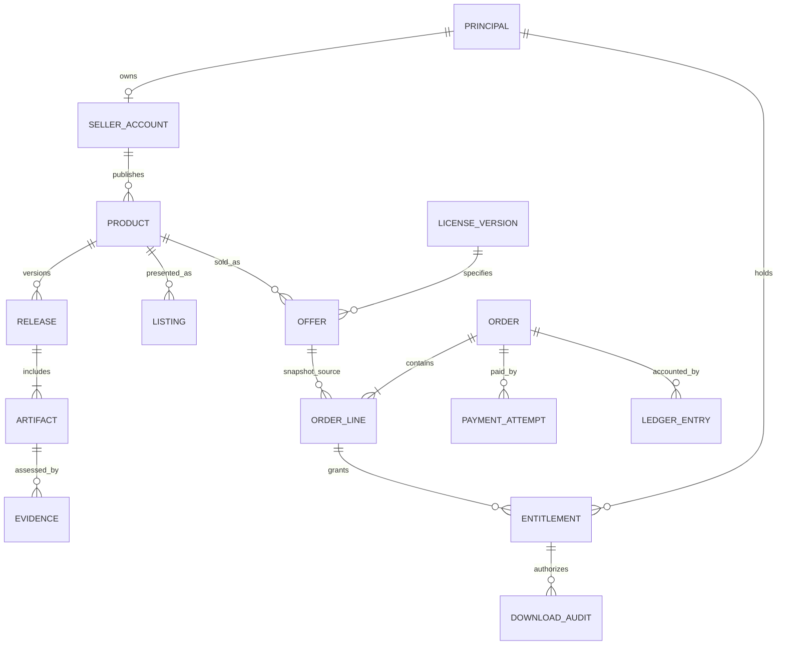
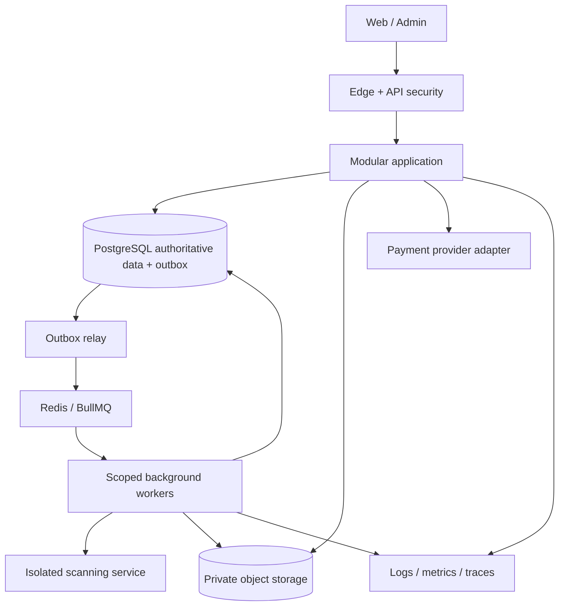

# MEDUZELLAR — Marketplace-ի գլխավոր ճարտարապետություն

**Տարբերակ՝** 1.1 — իրականացմանը նախապատրաստող նախագծային սպեցիֆիկացիա  
**Ամսաթիվ՝** 2026-11-25  
**Շրջանակ՝** Marketplace-ի սահմանված արտադրանքային տիրույթը, ոչ թե Meduzellar-ի ամբողջ հարթակը։  
**Իրավասություն՝** ռազմավարական Blueprint-ը հաստատված է սեփականատիրոջ կողմից։ Ստորև բերված մանրամասն նախագծային և տեխնոլոգիական ընտրությունները ճարտարապետի առաջարկներ են՝ մինչև repository-ի մակարդակով վերանայումը։  
**Փուլ՝** պլանավորում / Phase A։ Փաստաթուղթը չի թույլատրում ստեղծել ծրագրային կառուցվածք, տեղադրել dependencies, ստեղծել migrations, ակտիվացնել CI կամ կատարել deployment։

## 0. Ընթերցման ուղեցույց և որոշումների իրավասություն

Այս հայերեն Markdown սպեցիֆիկացիան նախատեսված է Cursor-ի և ինժեներական վերանայման համար։ MUST՝ առաջարկվող պարտադիր պահանջ, եթե ավելի բարձր իրավասությամբ հաստատված կանոնը չի գերակայում։ SHOULD՝ առաջարկվող լռելյայն մոտեցում, որի բացառությունները փաստաթղթավորվում և համաձայնեցվում են governance-ի համաձայն։ P0՝ սկզբնական թողարկում, P1՝ հիմնավորված աճ, P2՝ հետագա ընդլայնում։ Որևէ թիրախ կամ մատակարար չի ներկայացվում որպես արդեն չափված կամ պայմանագրով հաստատված։

Մինչև իրականացումը կարդալ repository-ի AGENTS.md-ը, կիրառելի agent rules-ը, առկայության դեպքում՝ հաստատված TECH_CARD-ը և 01-ARCHITECTURE-ը։ Համեմատել այս սպեցիֆիկացիայի հետ և ներկայացնել հակասությունները՝ առանց դրանք լուռ լուծելու։ Գործող անվտանգության անփոփոխ կանոնները գերակայում են։ Փաստաթղթի պատրաստման ընթացքում իրական repository-ն չի ստուգվել։ Ֆայլերի ուղիներն առաջարկներ են, ոչ գործող ֆայլերը վերագրելու հրահանգներ։ Սեփականատերը հաստատել է 12 բաժինների ընդհանուր Blueprint-ը և ինքնուրույն նախագծման մեթոդաբանությունը, ոչ յուրաքանչյուր մանրամասն առաջարկը կամ իրականացման գործողությունը։

| Որոշում | Ուղղություն | Կարգավիճակ |
|---|---|---|
| MP-DEC-001 A | Վստահություն + ծրագրավորողի արտադրողականություն | Owner Approved |
| MP-DEC-001 B | Ընտրված կատեգորիաներ + Hybrid Typed Catalog | Owner Approved |
| MP-DEC-001 C | Ամբողջական զարգացող կյանքի ցիկլ, անկախ իրավունքներ, թափանցիկ սպասարկում, արժեքով պահպանում, համատեղ պատասխանատվություն, փուլային զարգացում | Owner Approved |
| MP-DEC-001 D | Ապացույցների վրա հիմնված ընդլայնում | Owner Approved |
| MP-DEC-002 | Անհատներ + կազմակերպություններ, միասնական վաճառողի մոդել, վերահսկվող ընդունում | Architect Proposed՝ հաստատված Blueprint-ի շրջանակում |
| MP-DEC-003 | Անհատ և կազմակերպություն գնորդներ | Architect Proposed |
| MP-DEC-004 | Տարբերակավորված արտադրանքներ և ստանդարտացված առաջարկներ | Architect Proposed |
| MP-DEC-005 | Ավտոմատ և մարդկային ռիսկահեն ստուգում | Architect Proposed |
| MP-DEC-006 | Գործարքներից սկսվող հիբրիդային եկամտային մոդել | Architect Proposed |
| MP-TECH-001 | Մոդուլային մոնոլիտ և մեկուսացված workers, տեխնոլոգիական թեկնածուները՝ §10-ում | Architect Proposed |

## 1. Արտադրանքային և բիզնես ճարտարապետություն (Product & Business)

### 1.1 Առաքելություն և շրջանակ

Կառավարվող երկկողմանի թվային տեխնոլոգիական Marketplace, որն ապահովում է ծրագրային արտադրանքների օրինական հայտնաբերում, գնահատում, գնում, տրամադրում, օգտագործման ներդրում և սպասարկում։ Հարթակը տրամադրում է վերահսկվող գործարքների և ապացույցների շերտ։ Այն չի երաշխավորում անթերի ծրագրակազմ, սեփականության իրավունքի անվիճելիություն, հաջող ինտեգրում, վաճառողի եկամուտ կամ իրավական համապատասխանություն։ Գնորդը պատասխանատու է deployment-ի որոշումների համար։ Վաճառողի պարտավորությունները բխում են ընդունված պայմաններից։ Հարթակի իրավական դերը դեռ որոշված չէ։

Հիմնական լսարան՝ ծրագրավորողներ, անկախ հեղինակներ, freelancer-ներ և փոքր ծրագրային ընկերություններ։ Երկրորդային՝ startup-ներ և agency-ներ, ապագայում՝ enterprise գնումներ։ Հայաստանից սկսվող վավերացումը՝ միջազգային հավակնությամբ, պլանավորման վարկած է, ոչ որևէ իրավազորությունում առևտուր իրականացնելու թույլտվություն։ Գումար ընդունելուց առաջ ստուգել երկրի հասանելիությունը։

| Հնարավորություն | P0 | P1 | P2 |
|---|---|---|---|
| Կատալոգ | Frontend/UI, Backend Modules, Developer Tools | Complete Projects և Plugins՝ վերահսկվող pilot | AI, դիզայնի նյութեր, API, mobile, բիզնես լուծումներ |
| Առևտուր | Մեկ վաճառող, մեկ առաջարկ, մեկ արժույթ յուրաքանչյուր պատվերում | Միևնույն վաճառողի մի քանի ապրանք, հիմնավորված դեպքում՝ կտրոններ | Բազմավաճառող հաշվարկ, enterprise գնումներ |
| Վստահություն | Release-ին հատուկ ապացույցներ, ձեռքով ընդունում, սկանավորում | Համատեղելիության ստուգումներ, հարուստ ապացույցներ | Մասնագիտացված գնահատման ծրագրեր |
| Գնորդի հաջողություն | Գրադարան, փաստաթղթեր, իրավասու release-ներ, հիմնական աջակցություն | Ինտեգրման ստուգացանկ, թարմացումներ | AI օգնական, workspace, արտադրանքի առողջություն |
| Վաճառող | Onboarding, Store, սևագրեր, release ներկայացում, պատվերներ, եկամուտներ | Պահանջարկի վերլուծություն, analytics | Թիմային աշխատանք և ընտրովի վճարովի գործիքներ |
| Office | Հիմնական անդամակցություն և լիազորված անձնական/կազմակերպական համատեքստ | Լիազորում և գնումների վերահսկում | Enterprise լիցենզավորում և հաստատումներ |

P0-ի շրջանակից դուրս են՝ կամայական կոդի հոսթինգով կատարումը, DRM երաշխիքները, ավտոմատ production deployment-ը, գումարների պահառությունը, բազմավաճառող զամբյուղը, անկախ համահեղինակների եկամուտների բաժանումը, սեփական լիցենզավորման DSL-ը, բոլոր երկրներում առևտուրը և AI-ից կախված պատվերի կատարումը։ Սկսել փոքր ընտրված առաջարկով և մարդկային աջակցությամբ onboarding-ից։

### 1.2 Դերակատարներ և արժեք

| Դերակատար | Նպատակ | Սահման |
|---|---|---|
| Այցելու | Գտնել և գնահատել արտադրանք | Միայն հանրային հրապարակված տվյալներ |
| Գնորդ | Գնել իր կամ թույլատրված կազմակերպության համար | Միայն սեփական/լիազորված պատվերներ և իրավունքներ |
| Անհատ վաճառող | Եկամուտ ստանալ սեփական տարածման իրավունքներից | Միայն սեփական Seller Account |
| Office սեփականատեր/ներկայացուցիչ | Վաճառել կամ գնել կազմակերպության անունից | Անդամակցության և գործողության թույլտվությունների սահմաններում |
| Reviewer | Գնահատել ներկայացված release-ները | Չի ստուգում սեփական կամ շահերի բախմամբ արտադրանքը |
| Support operator | Լուծել հաճախորդի խնդիրները | Միայն կոնկրետ case, առանց անսահման artifact հասանելիության |
| Finance operator | Համադրել պատվերներն ու վերադարձները | Չի խմբագրում պատմական գրառումները կամայականորեն |
| Security operator | Սահմանափակել վտանգված արտադրանքի տարածումը | Audit-ով սահմանափակում, ոչ իրավունքի ավտոմատ չեղարկում |
| System worker | Կատարել նեղ շրջանակով ֆոնային աշխատանքներ | Ծառայության ինքնություն, առանց ընդհանուր admin իրավասության |

### 1.3 Հիմնական բիզնես կանոններ

- BR-001. Յուրաքանչյուր Seller Account ունի ճիշտ մեկ իրավատեր՝ անհատ կամ կազմակերպություն։ User-ը կարող է աշխատել մի քանի լիազորված համատեքստում՝ առանց անձնական և Office ակտիվները միավորելու։
- BR-002. Վաճառողի ընդունումը, ինքնության հաստատումը, տարածման իրավունքի ապացույցը, release-ի հաստատումը, վճարման և payout-ի իրավասությունները անկախ են։
- BR-003. Listing-ի հրապարակումը պահանջում է իրավասու վաճառող, հաստատված անփոփոխ release, վավեր offer և պարտադիր ապացույցներ։ Վճարովի պատվերի համար նաև երկրի և վճարման իրավասություն է անհրաժեշտ։
- BR-004. Product, Release, Artifact, Listing, Offer, License Version, Order, Payment և Entitlement հասկացություններն անկախ են։
- BR-005. Order-ը պահում է անփոփոխ առևտրային պայմաններ։ Գումարները պահվում են ամբողջ թվերով՝ արժույթի փոքրագույն միավորով, ISO արժույթով և դրան համապատասխան ճշտությամբ։
- BR-006. Հաստատված վճարումը անհրաժեշտ է, բայց ինքնին Entitlement չէ։ Կատարումը յուրաքանչյուր order line-ի և grant type-ի համար իրավունքը տրամադրում է մեկ անգամ։
- BR-007. Աջակցության/թարմացման ժամկետի ավարտը չի չեղարկում անկախ օգտագործման իրավունքը։ Հրապարակման կամ վաճառողի գործունեության դադարեցումը չի չեղարկում նախկին գնումներն ավտոմատ։
- BR-008. Վտանգավոր artifact-ի տրամադրումը կարող է արգելափակվել անկախ Entitlement-ի վիճակից։ Տեղեկացնել ազդված գնորդներին և կազմակերպել լուծում՝ կիրառելի պայմանների համաձայն։
- BR-009. Վստահության ապացույցները չեն վաճառվում։ Հովանավորվող տեղադրումը նշվում է և չի շրջանցում ստուգումը։
- BR-010. AI-ի և Messenger-ի խափանումը չի խոչընդոտում կատալոգի, առևտրի, իրավունքների և հիմնական աջակցության աշխատանքը։
- BR-011. Պատմական ֆինանսական գրառումները միայն հավելվում են։ Ուղղումը կատարվում է հակադարձ կամ կարգավորող գրառումով՝ պատճառի և դերակատարի նշումով։
- BR-012. Սեփականության/payout-ի փոփոխությունները պահանջում են ուժեղացված ստուգում և audit-ով հաստատում։ Պայմանագրային պարտավորությունները լուռ չեն փոխանցվում։

## 2. Մրցակցային ուսումնասիրություն (Competitive Intelligence)

Մրցակցային հիմքը վարկածների հավաքածու է, ոչ ընթացիկ ֆունկցիոնալների կամ գների ստուգված աուդիտ։ Համեմատել CodeCanyon/Codester-ը (կոդի տարածում), Gumroad-ը (հեղինակների առևտուր), GitHub Marketplace-ը (developer apps), բաց կոդի registry-ները (անվճար այլընտրանքներ), AI coding գործիքները (ինքնուրույն ստեղծելու այլընտրանք)։ Առանց ապացույցի չպնդել բացառիկություն։

| Տարբերակիչ ուղղություն | Մեխանիզմ | Վավերացում |
|---|---|---|
| Տեխնիկական վստահություն | Product Passport՝ ապացույցի շրջանակով և ամսաթվով | Գնորդը մինչև վճարումը կարողանում է հասկանալ սահմանափակումները |
| Արտադրողականություն | Համատեղելիության metadata և տեղադրման փաստաթղթեր | Իրական ինտեգրման ժամանակի համեմատություն այլընտրանքի հետ |
| Վաճառողի հաջողություն | Պարզ հրապարակում, օգտակար analytics | Առաջին հրապարակման և վաճառքի խմբեր |
| Հետգնման արժեք | Իրավունքներ, ներբեռնումներ, թարմացումներ և աջակցություն | Հաստատված օգտագործում և կրկնակի գնումներ |
| Էկոհամակարգ | Ընտրովի Network, Messenger, AI կապեր | Retention-ի և ծախսի հավելյալ ազդեցության փորձարկում |

Կատարել համեմատական առաջադրանքների թեստեր, փաստաթղթավորել աղբյուրներն ու ամսաթվերը, հարցազրույց անցկացնել իրական գնորդների և վաճառողների հետ, գրանցել այլընտրանքներն ու վճարելու պատրաստակամությունը։ Չօգտագործել մրցակիցների հեղինակային իրավունքով պաշտպանված բովանդակությունը կամ չհավաքել մասնավոր տվյալներ scraping-ով։ Մրցակցային ռեգիստրը եռամսյակային թարմացնել միայն գործառնական հիմնավորման դեպքում։ P0-ի առաջնահերթությունը վստահությունն ու ամբողջական առևտրային ցիկլն է, ոչ ֆունկցիոնալների քանակով հավասարվելը։

## 3. Տիրույթների ճարտարապետություն (Domain Architecture)

### 3.1 Bounded Context-ներ և տվյալների սեփականություն

Սկզբում մոդուլային մոնոլիտ։ Տրամաբանական սահմանները առանձին deployable service-ներ չեն։ Յուրաքանչյուր մոդուլ կառավարում է սեփական գրառումները և տրամադրում տիպավորված application commands/queries։ Արգելված են այլ մոդուլի տվյալների ուղղակի SQL փոփոխությունները և private repository-ների import-ը։ Read projection-ները կարող են միավորել հանրային փաստերը, բայց չեն հանդիսանում ֆինանսների կամ authorization-ի հեղինակավոր աղբյուր։

| Context | Հեղինակավոր գրառումներ | Միջերեսներ / կախվածություններ |
|---|---|---|
| Seller | SellerAccount, Application, Store, VerificationReference, Restriction | Identity/Organization պայմանագիր, իրավասության query |
| Buyer | BuyerContext, գնման դերակատարի/շահառուի հղումներ | Ընդհանուր ինքնություն և անդամակցություն |
| Catalog | Product, Category, ProductType, Listing, Offer, MetadataSchema | Release/ապացույցի իրավասություն, հանրային read model |
| Publishing | Release, ArtifactReference, ներկայացման workflow | Storage, Trust, տարբերակի ստեղծում |
| Trust | Review, CheckRun, Evidence, DistributionBlock | Artifact digest, անվտանգության վերահսկում |
| Commerce | Order, OrderLine, TermsSnapshot, կատարման վիճակ | Catalog quote, Payments, Entitlements |
| Payments (shared) | PaymentAttempt, ProviderEvent, RefundAttempt | Provider adapter, հաստատված արդյունքի contract |
| Licensing | LicenseTemplateVersion, իրավունքների նկարագրություն | Commerce-ի պայմանների snapshot |
| Entitlements | Grant, GrantHistory, assignments՝ եթե աջակցվում են | Commerce-ի հաստատված կատարում, Delivery |
| Delivery | DownloadAuthorization, DeliveryAudit | Entitlement, Trust block, մասնավոր storage |
| Customer Success | Library projection, օգտագործման արձագանք | Entitlements, Publishing, Support |
| Support | Case, CaseMessage, պայմանների snapshot | Order/entitlement, ընտրովի Messenger adapter |
| Disputes | Dispute, evidence refs, Resolution | Payments, Commerce, Entitlements, Settlement |
| Reputation | VerifiedReview, moderation history, aggregate projection | Order և գնման հաստատում |
| Settlement | LedgerEntry, SettlementBatch, PayoutReference, reconciliation | Payments և Commerce events |
| Discovery | Search projection, filters | Միայն հրապարակված Catalog |
| Growth Intelligence | Նվազագույն product events, cohorts | Հաստատված event schemas |
| Shared platform | User, Organization, Membership, storage, notifications | Հարթակի սեփական contracts. Marketplace-ը չի վերասահմանում դրանք |

### 3.2 Կոնցեպտուալ մոդել և կապերի քանակականություն



P0 սահմանափակումներ՝ մեկ ակտիվ Seller Account յուրաքանչյուր իրավատիրոջ համար, մեկ վաճառող և մեկ offer line յուրաքանչյուր պատվերում, կայուն ներքին ID-ներ, Product-ի շրջանակում եզակի release version, ներկայացումից հետո անփոփոխ artifact digest, ստեղծումից հետո անփոփոխ order line terms, եզակի grant key `(order_line_id, grant_type, scope_key)`, provider event-ի եզակիություն ըստ provider/account/event ID-ի, ledger operation-ի եզակիություն ըստ բիզնես գործողության և արժույթի։ Ապագա բազմաապրանք schema-ի աջակցությունը չի թույլատրում բացել բազմաապրանք checkout։ Օգտագործել database constraints և application validation։ Չօգտագործել չսահմանափակված polymorphic foreign keys. օգտագործել վավերացված principal reference կամ տիպավորված հղումներ՝ ամբողջականության ստուգումներով։ Չկատարել գնումների, audit-ի կամ ֆինանսական պատմության cascading deletion։

### 3.3 Նվազագույն դաշտերի պայմանագիր (տրամաբանական, ոչ վերջնական SQL)

| Գրառում | Պարտադիր դաշտեր / սահմանափակումներ |
|---|---|
| SellerAccount | id, principalRef, status, eligibilityVersion, createdAt |
| Product | id, sellerId, categoryId, typeId, slug, lifecycleStatus |
| Release | id, productId, version, state, metadataSchemaVersion, manifestDigest, submittedAt |
| Artifact | id, releaseId, storageKey, sha256, byteSize, mediaType, quarantineState |
| Evidence | id, releaseId, artifactDigest, checkType, toolVersion, policyVersion, outcome, checkedAt, scope, limitations, reviewerRef |
| Offer | id, productId, eligibleReleasePolicy, priceMinor, currency, licenseVersionId, status, version |
| Order | id, buyerPrincipalRef, actorRef, sellerId, currency, totalMinor, status, createdAt |
| OrderLine | id, orderId, offerId, termsSnapshot, productId, releaseId, amountMinor |
| PaymentAttempt | id, orderId, providerRef, providerAccountRef, state, amountMinor, currency |
| Grant | id, beneficiaryRef, orderLineId, type, scopeKey, startsAt, endsAt?, status, termsVersion |
| LedgerEntry | id, journalRef, accountRef, amountMinor, currency, operationRef, postedAt |
| SupportCase | id, requesterRef, orderLineRef, sellerRef, status, policySnapshot |
| AuditRecord | id, actorRef, contextRef, action, resourceRef, outcome, reason, correlationId, timestamp |

Գումարները ստուգել overflow-ի համար։ Ժամանակային արժեքները պահել UTC-ով, ցուցադրել հստակ ժամային գոտով։ Զգայուն provider/KYC տվյալները հնարավորության դեպքում պահել հղումներով, ոչ պատճեններով։ Metadata schema-ները տարբերակավորված են և allowlist-ով սահմանված ըստ Product Type-ի։ Չկառուցել համընդհանուր rules engine։

### 3.4 Վիճակների մեքենաներ (State Machines)

| Aggregate | Վիճակներ և անցման պայմաններ |
|---|---|
| Seller | DRAFT → APPLIED → REVIEW → APPROVED → ACTIVE; REVIEW → REJECTED; ACTIVE → SUSPENDED → REVIEW կամ ACTIVE՝ ուղղումից հետո; ACTIVE/SUSPENDED → CLOSING → CLOSED՝ պարտավորությունների լուծման պլանից հետո։ Իրավասության առանձին չափումներ։ |
| Release | DRAFT → SUBMITTED → QUARANTINED → REVIEWING → APPROVED կամ CHANGES_REQUIRED/REJECTED։ Ուղղումը նոր անփոփոխ ներկայացում է ստեղծում, հաստատումը կապված է digest-ին։ APPROVED → SUPERSEDED կամ WITHDRAWN։ Անվտանգության block-ը անկախ է։ |
| Listing | DRAFT → PUBLISHED → UNLISTED/ARCHIVED։ Հրապարակման guard-ը ստուգում է վաճառողին, offer-ը, հաստատված release-ը և blocks-ը։ |
| Order | CREATED → PAYMENT_PENDING → PAID → FULFILLMENT_PENDING → FULFILLED։ Մինչև վճարումը՝ չեղարկում/ժամկետի ավարտ, վճարված բացառությունները՝ լուծման հերթ։ Refund/dispute վիճակներն անկախ են։ Չնշել վճարված պատվերը cancelled՝ գումարը թաքցնելու նպատակով։ |
| Payment | INITIATED → PENDING → SUCCEEDED/FAILED/EXPIRED։ Ուշ հաջող վճարումը համադրվում է, refund/chargeback-ը առանձին գրառում է։ |
| Grant | PENDING → ACTIVE → EXPIRED/SUSPENDED/REVOKED միայն լիազորված քաղաքականությամբ։ Կասեցումը վերականգնելի է, ժամկետի ավարտը՝ միայն պայմաններով սահմանված դեպքում։ |
| Support | OPEN → IN_PROGRESS → WAITING_CUSTOMER/WAITING_SELLER → RESOLVED → CLOSED։ Վերաբացում՝ քաղաքականության համաձայն։ |

Յուրաքանչյուր անցում transaction-ի մեջ ստուգում է ընթացիկ վիճակն ու տարբերակը, գրանցում դերակատարին և պատճառը, անհրաժեշտության դեպքում արտածում outbox event։ Կրկնվող անցումները պետք է անվտանգ լինեն։

### 3.5 Իրադարձություններ և հուսալիություն

Անմիջական authorization-ի և անփոփոխ կանոնների համար օգտագործել synchronous module calls, asynchronous ազդեցությունների համար՝ durable outbox։ Ենթադրել at-least-once delivery, ոչ exactly-once։ Event envelope՝ eventId, eventType, schemaVersion, aggregateId, aggregateVersion, occurredAt, correlationId, causationId, նվազագույն payload։ Consumer-ները կրկնությունները կանխում են event ID-ով և business key-ով, retry-ները սահմանափակ են՝ backoff-ով և dead-letter հետաքննությամբ։ Չտեղադրել զգայուն տվյալներ events-ում։

Իրադարձություններ՝ SellerEligibilityChanged, ReleaseSubmitted, ReleaseApproved, ArtifactBlocked, ListingPublished, OrderCreated, PaymentVerified, FulfillmentCompleted, EntitlementGranted, RefundConfirmed, DisputeResolved, PayoutReconciled, SupportCaseOpened։ Analytics events-ը չի ղեկավարում ֆինանսների կամ Entitlements-ի գրառումները։ Անհերթ իրադարձությունները չպետք է հետ տան հեղինակավոր վիճակը. անհրաժեշտության դեպքում համադրել ընթացիկ վիճակի հետ։

## 4. Ֆունկցիոնալ ճարտարապետություն և API պայմանագրեր

### 4.1 Պահանջների ցանկ

| ID | P | Հնարավորություն | Ընդունման չափանիշ |
|---|---|---|---|
| FR-01 | P0 | Դիտում/որոնում/ֆիլտր | Միայն հրապարակված իրավասու listing-ներ, կայուն cursor pagination |
| FR-02 | P0 | Արտադրանքի էջ/անձնագիր | Մինչև գնումը ցուցադրում է գինը, արժույթը, իրավունքները, release-ը և ապացույցների շրջանակը |
| FR-03 | P0 | Վաճառողի դիմում | Սևագիրը պահպանվում է, վիճակն ու անհրաժեշտ ստուգումները տեսանելի են |
| FR-04 | P0 | Product Draft | Տիպավորված metadata-ն ստուգվում է, վաճառողի համատեքստը պարտադիր է |
| FR-05 | P0 | Release Upload | Մասնավոր quarantine, չափի/տեսակի սահմաններ, գրանցված digest |
| FR-06 | P0 | Review | Որոշումը կապված է քաղաքականության/digest-ի հետ, պատճառները audit-վում են |
| FR-07 | P0 | Հրապարակում | Անիրավասու վաճառող/release/offer-ը մերժվում է server-side |
| FR-08 | P0 | Checkout | Server-ի հաշվարկած գումար և տարբերակավորված պայմանների հստակ ընդունում |
| FR-09 | P0 | Վճարման հաստատում | Ստուգվում է ստորագրված provider event-ը, գումարը, արժույթը, պատվերը |
| FR-10 | P0 | Պատվերի կատարում | Յուրաքանչյուր համապատասխան իրավունքի համար մեկ business grant՝ անգամ կրկնվող events-ի դեպքում |
| FR-11 | P0 | Գրադարան | Ցուցադրում է սեփական իրավունքները, իրավասու release-ները և սահմանափակումները |
| FR-12 | P0 | Ներբեռնում | Ստուգվում են իրավունքը, շահառուն, release eligibility-ն և block-ը |
| FR-13 | P0 | Աջակցություն | Գնորդը բացում և հետևում է case-ին, վաճառողը տեսնում է միայն թույլատրված case-երը |
| FR-14 | P0 | Refund/dispute | Հետագծելի դիմում, որոշում, provider-ի հաստատում և իրավունքների կառավարում |
| FR-15 | P0 | Վաճառողի եկամուտ | Համադրված հաշվեկշռի բացվածք, առանց կեղծ payout հասանելիության |
| FR-16 | P0 | Organization context | Անդամակցության դադարեցումն անմիջապես կանխում է հետագա չլիազորված գործողությունները |
| FR-17 | P0 | Admin operations | Review, restrictions, reconciliation, audit, incident workflows |
| FR-18 | P0 | Հաստատված կարծիքներ | Գնումը հաստատված է, մեկ կարծիք ըստ գնորդ/արտադրանք քաղաքականության, չարաշահումների moderation |
| FR-19 | P1 | Համատեղելիություն | Տարբերակի վրա հիմնված սահմանափակումներ և unknown վիճակ, առանց կեղծ երաշխիքների |
| FR-20 | P1 | Պահանջարկի վերլուծություն | Համախմբված չբավարարված պահանջարկ՝ գաղտնիության շեմերով |
| FR-21 | P2 | AI ինտեգրում | Ընտրովի սահմանափակ օգնություն, առանց չլիազորված կոդի հասանելիության |

### 4.2 Առաջարկվող HTTP API

Բոլոր ուղիները հարաբերական են `/api/v1/marketplace`-ին, եթե shared platform contract-ը այլ բան չի սահմանում։ JSON, OpenAPI, հստակ request/response DTO-ներ, schema validation և resource-level authorization։ Route ID-ները անթափանց են։ Համատեքստը ընտրվում է server-side ստուգված անդամակցությամբ, ոչ հաճախորդի չստուգված հայտարարությամբ։

| Method / route | Նպատակ | Թույլտվություն |
|---|---|---|
| GET /categories | Ակտիվ կատեգորիաների read model | Հանրային |
| GET /products | Հրապարակված listing-ների որոնում/ֆիլտր | Հանրային |
| GET /products/{slug} | Մանրամասներ, ընթացիկ առաջարկներ, անձնագիր | Հանրային |
| POST /seller/applications | Դիմել ընտրված իրավատիրոջ անունից | Նույնականացված իրավատեր/ներկայացուցիչ |
| GET /seller/account | Սեփական իրավասություն և վիճակ | Seller scope |
| POST /seller/products | Ստեղծել սևագիր | Product manage |
| PATCH /seller/products/{id} | Խմբագրել փոփոխելի դաշտերը | Product manage, տարբերակի նախապայման |
| POST /seller/products/{id}/releases | Ստեղծել release-ի սևագիր | Release submit |
| POST /seller/releases/{id}/uploads | Ստեղծել սահմանափակ upload intent | Release submit |
| POST /seller/releases/{id}/submit | Կնքել ներկայացումը և հերթագրել ստուգումը | Release submit |
| POST /seller/products/{id}/offers | Ստեղծել offer-ի տարբերակ | Pricing manage |
| POST /seller/products/{id}/publish | Դիմել հրապարակման համար | Publish permission |
| GET /seller/orders | Թույլատրված վաճառքներ | Seller order read |
| GET /seller/earnings | Համադրված ֆինանսական տվյալներ | Finance read |
| POST /checkout/quotes | Server-ի հաշվարկած առաջարկ | Գնորդ/ներկայացուցիչ |
| POST /orders | Ստեղծել պատվեր չժամկետանց quote-ից | Buyer purchase, idempotency key |
| POST /orders/{id}/payment-attempts | Սկսել provider checkout | Պատվերի իրավատեր/ներկայացուցիչ, idempotency key |
| GET /orders/{id} | Պատվերի/վճարման/կատարման ամփոփում | Թույլատրված գնորդ կամ operator |
| POST /webhooks/payments/{provider} | Provider callback | Provider signature + replay controls |
| GET /library | Իրավունքներ և իրավասու release-ներ | Beneficiary scope |
| POST /library/{grantId}/downloads | Թույլատրել կոնկրետ release/artifact | Grant շահառու/ներկայացուցիչ |
| POST /support/cases | Բացել սահմանված case | Իրավասու գնորդ |
| POST /support/cases/{id}/messages | Case հաղորդագրություն | Case-ի մասնակից |
| POST /orders/{id}/refund-requests | Դիմել վերադարձի համար | Գնորդ/ներկայացուցիչ |
| POST /products/{id}/reviews | Հաստատված կարծիք | Իրավասու գնորդ |
| GET /admin/reviews | Ստուգման հերթ | Reviewer |
| POST /admin/reviews/{id}/decisions | Հաստատել/մերժել/պահանջել ուղղում | Reviewer՝ առանց շահերի բախման |
| POST /admin/artifacts/{id}/blocks | Սահմանափակել վտանգավոր տրամադրումը | Security operator |
| POST /admin/disputes/{id}/resolve | Գրանցել վեճի լուծումը | Լիազորված operator |
| GET /admin/reconciliation | Չհամադրված ֆինանսական գրառումներ | Finance operator |

Պայմանագրի օրինակ (պայմանական)՝

```json
{"offerId":"of_opaque","offerVersion":3,"buyerContextId":"ctx_opaque"}
```

Quote-ի պատասխանը՝ `quoteId`, `expiresAt`, `currency`, `totalMinor`, `termsVersion`, `termsDigest`, ապրանքի ամփոփում։ Order ստեղծելիս ընդունվում են `quoteId`, `acceptedTermsDigest` և `Idempotency-Key` header։ Server-ը նորից ստուգում է իրավասությունը և quote-ի ժամկետը։ Client-ի գինը հեղինակավոր չէ։ Վճարման սկիզբը վերադարձնում է provider-ի hosted redirect կամ հաստատված tokenized flow. Marketplace-ը չի ընդունում քարտի հում տվյալներ։ Download request-ը փոխանցում է artifactId և releaseId, պատասխանը՝ կարճաժամկետ սահմանափակ URL կամ լիազորված proxy պատասխան, ոչ մշտական հանրային object URL։

Ստանդարտ սխալներ՝ 400 անվավեր մուտք, 401 չնույնականացված, 403 արգելված (կամ 404 թաքցվող ռեսուրսների համար), 404 չի գտնվել, 409 հնացած վիճակ/idempotency հակասություն, 422 բիզնես կանոնի խախտում, 429 չափազանց շատ հարցումներ, 503 կախվածությունն անհասանելի է։ Սխալի մարմին՝ `code`, անվտանգ `message`, `correlationId`, ընտրովի անվտանգ դաշտային մանրամասներ։ Ոչ stack trace, ոչ գաղտնի տվյալներ։ Idempotency key-ը սահմանված է ըստ դերակատարի/համատեքստի/գործողության։ Նույն բանալին և նույն request-ը վերադարձնում են սկզբնական արդյունքը, տարբեր payload-ը՝ հակասություն։ Փոփոխող endpoint-ները անհրաժեշտության դեպքում կիրառում են optimistic concurrency։ Որոնման sort/filter դաշտերը allowlist-ով են, էջի չափը՝ սահմանափակ։

### 4.3 Կրիտիկական աշխատանքային հաջորդականություններ

**Հրապարակում.** լիազորել վաճառողին → ստեղծել սևագիր → տրամադրել սահմանափակ մասնավոր upload intent → ստուգել digest/չափ → կնքել manifest → quarantine → ավտոմատ ստուգումներ → մարդկային ռիսկահեն վերանայում → գրանցել ապացույց → հրապարակել իրավասու listing → թարմացնել search projection։ Պարտադիր scanner-ի ձախողումը կամ անհասանելիությունը արգելափակում է հաստատումը։ Անվստահելի archive-ը չի կատարվում API process-ում։

**Գնում.** ստուգել համատեքստը → հաշվարկել ընթացիկ offer/պայմանները → ատոմային ստեղծել order snapshot → սկսել provider վճարում կայուն operation key-ով → ստուգել callback-ը browser redirect-ից անկախ → transaction-ով գրանցել վճարման արդյունքը և outbox-ը → fulfillment worker-ը ստուգում է հեղինակավոր վիճակը և մեկ անգամ grant է տալիս → հասանելի է Library-ն → reconciliation և notification։ Եթե վճարումից հետո իրավունքի տրամադրումը ձախողվում է, ցույց տալ սպասող կատարում, retry և alert։ Չգանձել կրկին։ Ժամկետից հետո ուշ վճարումը պահանջում է հստակ համադրման/վերադարձի քաղաքականություն, ոչ լուռ անտեսում։

**Ներբեռնում.** նույնականացնել → ստուգել grant-ը, շահառուին, շրջանակը, տարբերակը և artifact block-ը → տրամադրել կարճաժամկետ հղում → գրանցել authorization-ը, հնարավորության դեպքում storage access logs։ Արդեն տրամադրված signed URL-ը կարող է վավեր մնալ մինչև ժամկետի ավարտը, ուստի շտապ արգելափակման համար օգտագործել կարճ TTL կամ միջնորդավորված հասանելիություն։ Ներբեռնված պատճենները հեռակա հետ կանչել հնարավոր չէ։

**Վերադարձ.** դիմում → ստուգել քաղաքականությունը/իրավասությունը և սկզբնական գործարքը → հաստատված provider refund request (idempotent) → հաստատել provider-ի արդյունքը → ավելացնել հակադարձ գրառումներ → կիրառել հստակ հաստատված ազդեցությունը իրավունքների վրա → տեղեկացնել գնորդին/վաճառողին։ HTTP initiation-ից չեզրակացնել provider-ի հաջողությունը։ Chargeback-ի կառավարումն առանձին է և հետագծելի։

## 5. Օգտատիրոջ փորձառություն և հաճախորդի ճանապարհ (UX & Customer Journey)

| Միջավայր | P0-ի պարտադիր վարքագիծ |
|---|---|
| Marketplace home/category/search | Հստակ ֆիլտրեր, արդյունք չգտնելու դեպքում այլընտրանք, բեռնման/սխալի վիճակներ, համապատասխան հրապարակված արտադրանքներ |
| Product Details | Վաճառող, release, գին, լիցենզիա, աջակցություն/թարմացում, ապացույցների սահմանափակումներ, անհայտ համատեղելիություն, փաստաթղթերի նախադիտում |
| Checkout | Հստակ գնորդի համատեքստ, վերջնական գին/արժույթ, պայմանների ընդունում, մշակվող/ձախողված/կատարման սպասող վիճակներ |
| Library | Իրավունքների ամփոփում, իրավասու release-ներ, ներբեռնման վիճակ, վտանգավոր artifact-ի զգուշացում, աջակցության հղում |
| Seller Onboarding | Փուլային դաշտեր, պահպանում/շարունակում, վերանայման պատճառներ, իրավասության ստուգացանկ |
| Seller Studio | Սևագրեր, release-ի վիճակ, մերժման ուղղում, վաճառքների և եկամուտների ամփոփումներ |
| Office Context Switcher | Մշտապես տեսանելի համատեքստ, զգայուն գործողությունների հաստատում, անձնական/կազմակերպական տվյալների չխառնում |
| Admin Console | Հերթեր, ապացույցներ, որոշումներ, audit և escalation, արտոնյալ գործողությունների հաստատում |

Առաջնահերթ՝ responsive web. Mobile app-ը P0 պահանջ չէ։ Ապահովել ստեղնաշարով կառավարում, labels, focus management, հակադրություն և սխալների հասանելի հայտարարում։ WCAG 2.2 AA-ը առաջարկվող չափանիշ է՝ վերանայման ժամանակ ստուգմամբ։ Տեղայնացնել տեքստերը, ամսաթվերը, արժույթները և հոգնակի ձևերը, չմիակցել թարգմանված հատվածներ մեխանիկորեն։ Առևտրային/իրավական թարգմանությունները վերանայել, AI թարգմանությունը հեղինակավոր չէ։ Որոնումը և գնումը գործում են առանց AI-ի։ Յուրաքանչյուր էջ սահմանում է համապատասխան empty, loading, forbidden, offline/degraded և retry վիճակները։ Սպասող վճարումը չներկայացնել որպես վճարված, իսկ ներբեռնումը՝ որպես հաջող օգտագործում։

## 6. Վստահության, անվտանգության և իրավական ճարտարապետություն

### 6.1 Սպառնալիքների մոդել (Threat Model) և վերահսկիչ միջոցներ

| Սպառնալիք | Առաջարկվող պարտադիր վերահսկում | Ստուգում |
|---|---|---|
| Cross-tenant access / IDOR | Server-side resource authorization յուրաքանչյուր գործողության համար, համատեքստով սահմանափակված queries | Բացասական թեստեր տարբեր user/Office-ների միջև |
| Session-ի հափշտակում | Անվտանգ session/token lifecycle, MFA արտոնյալ գործողությունների համար, revocation | Auth թեստեր և վերականգնման վարժանք |
| CSRF/CORS չարաշահում | Հստակ վստահելի origins, CSRF պաշտպանություն cookie-authenticated mutations-ի համար, առանց wildcard credentialed CORS-ի | Browser integration tests |
| Վնասակար upload | Մասնավոր quarantine, չափի/քանակի/ապասեղմման սահմաններ, path traversal-ի կանխում, մեկուսացված սկանավորում, կամայական execution-ի բացառում | Archive abuse fixtures |
| Վտանգված artifact | Անփոփոխ digest, դրան կապված ապացույց, distribution block և incident process | Tamper և block թեստեր |
| Կեղծ callback / replay | Raw-body signature validation՝ ըստ provider-ի պահանջի, dedupe, գումար/արժույթ/պատվեր ստուգում | Կեղծ/կրկնվող/անհերթ events-ի fixtures |
| Payout-ի ապօրինի կառավարում | Լրացուցիչ նույնականացում, հաստատված շահառու, հաստատման դերերի տարանջատում և alert | Չլիազորված փոփոխությունների թեստեր |
| Injection / XSS | DTO validation, պարամետրացված queries, output encoding, sanitized rich content, CSP | SAST/DAST և թեստեր |
| Տվյալների արտահոսք logs/AI | Redaction, նվազագույն արտոնություններ, համաձայնություն և նվազագույն տվյալներ | Log review և cross-context tests |
| Չարաշահում / spam | Rate limits, quotas, reporting և moderation | Load և abuse tests |

Կիրառել deny-by-default authorization։ Առաջարկվող permissions՝ `seller.product.manage`, `seller.release.submit`, `seller.publish`, `seller.finance.read`, `seller.payout.manage`, `buyer.purchase`, `buyer.grant.use`, `review.decide`, `security.block`, `finance.reconcile`, `dispute.resolve`։ Դերերը կապել permissions-ին, բայց միշտ ստուգել resource context-ը. միայն դերերի անունները բավարար չեն։ Owner-ը կարող է լիազորել, բայց չի կարող շրջանցել verification-ը։ Reviewer-ի և վաճառողի պարտականություններն առանձնացված են։ Արտոնյալ հասանելիությունը audit-վում է, արտակարգ հասանելիության համար անհրաժեշտ են պատճառ, շրջանակ և ժամկետ։

### 6.2 Արտադրանքի ստուգման քաղաքականություն

P0՝ կառուցվածքային ստուգումներ, հայտարարված լիցենզավորման/տարածման ապացույցներ, malware և secret scanning, կիրառելի դեպքում dependency analysis, փաստաթղթեր և ռիսկահեն ձեռքով գնահատում։ Սկզբում նախընտրել միայն source code պարունակող ցածր ռիսկով արտադրանքներ։ Executable packages-ը, authentication/payment modules-ը և plugins-ը պահանջում են ավելի խիստ քաղաքականություն կամ վերահսկվող pilot։ Scanner-ի սխալը UNKNOWN/FAILED է, ոչ PASS։ Ապացույցը ներառում է policy version, scope, tool/version, ամսաթիվ, digest և սահմանափակումներ։ Չօգտագործել «100% անվտանգ» նշան։ Վերագնահատել էական խոցելիությունների զեկույցները, արգելափակել վտանգավոր տրամադրումը, տեղեկացնել ազդված իրավատերերին և կազմակերպել ուղղում։ Չվազեցնել անվստահելի կոդը հիմնական application-ում կամ սովորական worker-ում։ Եթե հետագայում անհրաժեշտ լինի՝ առանձին վերանայված ժամանակավոր sandbox՝ սահմանափակ ցանցով, credentials-ով և ռեսուրսներով։

### 6.3 Տվյալներ և գաղտնիություն

Դասակարգել տվյալները՝ public, internal, confidential, restricted։ Հանրային projection-ները չպետք է պարունակեն մասնավոր artifacts, ֆինանսական տվյալներ, ինքնության փաստաթղթեր, support-ի բովանդակություն կամ ներքին review notes։ Գաղտնագրել փոխանցումն ու պահպանումը, առանձնացնել միջավայրերը, օգտագործել secret manager, պարբերաբար փոխել բանալիները, մաքրել logs-ը զգայուն տվյալներից։ Պահպանման/ջնջման ժամանակացույցը հաստատել ըստ իրավազորության և նպատակի։ Պարտադիր ֆինանսական/audit գրառումները պահպանել օրինական քաղաքականությամբ և նվազագույնի հասցնել չառնչվող անձնական տվյալները։ Տվյալների export/delete workflow-ը պետք է հաշվի առնի legal holds-ը և ձեռք բերված իրավունքները։ Գնորդի source code-ը կամ անձնական զրույցները լռելյայն չեն ուղարկվում AI-ին։ KYC նյութերի հասանելիությունը նվազագույնի հասցնել, հնարավորության դեպքում կիրառել provider references։

### 6.4 Թողարկումն արգելափակող իրավական որոշումներ

Երկրների հասանելիություն, վաճառողի իրավասություն և տարիքային/բիզնես պահանջներ, պայմանագրի կողմը և merchant-of-record/payment facilitator-ի պատասխանատվությունները, հարկային/VAT հաշիվները, payout/KYC/KYB պարտավորությունները, սպառողի վերադարձներն ու թվային բովանդակության կանոնները, IP takedown/appeal, գաղտնիություն և միջսահմանային փոխանցումներ, լիցենզիայի ձևանմուշներ և աջակցության/սպասարկման պարտավորություններ։ Պահանջվում է որակավորված իրավական վերանայում և provider-ի գրավոր հաստատված իրագործելիություն։ Չպնդել, որ ownership checks-ը ապացուցում է անվիճելի սեփականության իրավունք կամ մեկ քաղաքականությունը բավարար է բոլոր երկրների համար։

## 7. Եկամտայնացում և միավորի տնտեսագիտություն (Monetization & Unit Economics)

Սկզբնական թեկնածու՝ գործարքից միջնորդավճար։ Հետագայում՝ վճարովի analytics, AI, workspace, enterprise գործիքներ և հստակ նշված առաջխաղացումներ։ Հիմնական վստահությունը, գնված իրավունքները, պատվերների պատմությունը և բազային անվտանգությունը անկախ են Premium բաժանորդագրությունից։ Ճշգրիտ վճարը, վճարող կողմը, վերադարձի հաշվարկը և հարկային հիմքը դեռ որոշված չեն։ Չիրականացնել production սակագների համակարգ մինչև հաստատումը։

Միայն օրինակային սցենար (USD, առանց հարկերի)՝ պատվեր $49, միջնորդավճար 12% = $5.88, վճարման մշակում 3% + $0.30 = $1.77, աջակցություն $0.75, վերանայման վերագրված ծախս $0.50, տրամադրում $0.15, ակնկալվող ռիսկի կորուստ $0.50։ Contribution՝ $2.21 մեկ պատվերից։ Ամսական $1,000 պայմանական ֆիքսված ծախսով break-even-ը 453 պատվեր/ամիս է (կլորացում դեպի վեր)։ Ներառված չեն հաճախորդների ներգրավումը, սկզբնական մշակումը և այլ չնշված ծախսերը։ GMV-ն հարթակի եկամուտը չէ։ Իրական տնտեսագիտությունը գնահատելիս review-ի վերագրվող ծախսը պետք է ներառի նաև մերժված ներկայացումներն ու քիչ վաճառք ունեցող հեղինակներին։

Ֆինանսական ճարտարապետություն՝ յուրաքանչյուր արժույթի համար միայն հավելվող հավասարակշռված journal, կայուն operation references, առանձին seller payable/platform fee/provider clearing/refund adjustments՝ հաստատված հաշվապահական քաղաքականության համաձայն։ Չթույլատրել բացասական available payout առանց հստակ պարտքի քաղաքականության։ Հասանելի և սպասող գումարները հաշվարկել settlement-ի հաստատման, պահուստների և հաստատված պահումների հիման վրա։ Provider events-ը և statements-ը համադրել orders-ի, refunds-ի, ledger-ի և payouts-ի հետ։ Անհամապատասխանությունները ուղարկել operator queue, երբեք լուռ չվերագրել գրառումները։ Չենթադրել գումարների պահառություն. provider payout մեխանիզմներն ու իրավական մոդելը որոշում են ledger accounts-ի կառուցվածքը։ Provider-ի ընտրության ժամանակ ստուգել հայկական իրավաբանական անձի onboarding-ը, վաճառողների payout երկրները, արժույթները, marketplace split/settlement-ը, վերադարձները, disputes-ը, webhooks-ը, հարկային պատասխանատվությունը և sandbox-ի վարքագիծը։ Օրինական Marketplace գործարք չապահովող provider-ը թողարկման արգելք է։

## 8. Մարքեթինգի և աճի ճարտարապետություն

Սկսել ծրագրավորողների մեկ նեղ ուղղությունից և ընտրված որակյալ առաջարկից։ Առաջարկվող փորձարկում՝ 30 գնորդի, 20 հեղինակի և 10 Office-ի հարցազրույց, 10–20 founding creator։ Թվերը թիրախներ են, ոչ ապացույցներ։ Հարցնել իրական գնումների պատմության և վճարելու պատրաստակամության մասին, ոչ միայն կարծիք։ Մինչև վճարովի pilot՝ անհատական աջակցությամբ արտադրանքի ընտրություն և ոչ առևտրային prototype tests։ Վճարովի pilot միայն իրավական և վճարային պատրաստվածությունից հետո։

| Փորձարկում | Չափում | Որոշում |
|---|---|---|
| Founding Creator Outreach | Որակյալ դիմումներ, հաստատված առաջարկ, հրապարակման ժամանակ | Նվազեցնել onboarding-ի բարդությունը կամ նեղացնել կատեգորիաները |
| Technical SEO էջեր | Համապատասխան որոնումներ և conversion | Ներդնել միայն համապատասխան պահանջարկի դեպքում |
| Product Request Form | Եզակի կոնկրետ չբավարարված կարիքներ | Ձևավորել առաջարկը ըստ պահանջարկի |
| Գնորդի օգտագործման հետադարձ կապ | Հաստատված օգտագործում, անհայտ արդյունքներ, support ծախս | Բարելավել փաստաթղթերը կամ հեռացնել անորակ արտադրանքները |
| Referral Pilot | Լրացուցիչ որակյալ հաճախորդներ, fraud և CAC | Մասշտաբավորել միայն կենսունակ տնտեսագիտությամբ |

North Star թեկնածու՝ ամսական եզակի order-line հաջող օգտագործումների թիվը՝ գնորդի հաստատմամբ կամ համաձայնեցված ապացույցով, առանց կրկնակի հաշվարկի։ Unknown-ը failed չէ։ Adoption Coverage-ը չափել առանձին։ Վերահսկիչ չափանիշներ՝ refund/dispute rate, անվտանգության միջադեպեր, seller retention, contribution per order, առաջին վաճառքին հասնելու ժամանակ, հաճախորդների աջակցության ծանրաբեռնվածություն։ Նվազագույն analytics payload-ներ, առանց մասնավոր source code/chat հավաքագրման։ Ընդլայնման յոթ պայման՝ պահանջարկ, հաճախորդի արժեք, ֆինանսներ, տեխնիկական պատրաստվածություն, անվտանգություն/իրավական համապատասխանություն, գործառնություններ և ռազմավարություն։ Պարտադիր անվտանգության/իրավական պայմանները եկամտով չեն փոխհատուցվում։ Pilot → Limited Release → General Availability → Monitoring։ Կասեցումը կամ rollback-ը պահպանում են նախկին իրավունքները։ Նշանակալի ընդլայնման համար անհրաժեշտ է Owner Approval։

## 9. Էկոհամակարգի ինտեգրման ճարտարապետություն

Marketplace-ը պատասխանատու է առևտրի և իրավունքների համար։ Shared Identity/Organizations-ը՝ user-ների և անդամակցությունների, Payments-ը՝ provider-ի հետ փոխազդեցության, Network-ը՝ մասնագիտական պրոֆիլների, Messenger-ը՝ զրույցների, AI-ն՝ inference orchestration-ի համար։ Չփոփոխել այլ domain-ի աղյուսակները ուղղակիորեն։ Տարբերակավորել shared contracts-ը, հստակ սահմանել տվյալների նպատակը և authorization-ը, correlation IDs, timeouts և graceful degradation։

| Ինտեգրում | Contract | Խափանման վարքագիծ |
|---|---|---|
| Identity | Որոշել actor, principal, membership և permissions | Պաշտպանված փոփոխություններում fail closed, եթե authorization-ը չի հաստատվում |
| Payments | Ստեղծել payment/refund, հաստատել արդյունքները, համադրել | Pending վիճակ, առանց կրկնակի գանձման կամ չհաստատված grant-ի |
| Storage | Մասնավոր upload/download intent, metadata, integrity | Արգելափակել վտանգավոր/բացակայող artifact-ը, retry և alert |
| Notifications | Նվազագույն event և ստացողի scope | Անկախ retry, գնումը մնում է fulfilled |
| Network | Հանրային product projection՝ visibility control-ով | Marketplace-ը շարունակում է աշխատել, հնացած projection-ը վերակառուցվում է |
| Messenger | Լիազորված case-linked conversation adapter | Native case messages-ը մնում է հասանելի |
| AI | Թույլատրված product metadata և opt-in սահմանափակ մուտքեր | Հիմնական workflow-ն աշխատում է որոշակի կանոններով՝ առանց AI-ի |

AI-ն չի կայացնում վերջնական moderation, վճարային, Entitlement կամ իրավական որոշումներ։ Վերբեռնված արտադրանքի տեքստը համարել անվստահելի մուտք, ներառյալ prompt injection-ը։ Չտրամադրել ինքնավար հասանելիություն գաղտնի տվյալներին, production deployment-ին կամ ֆինանսական գործողություններին։

## 10. Տեխնիկական համակարգային ճարտարապետություն

### 10.1 Տեխնոլոգիական թեկնածուներ և հիմնավորում

| Շերտ | Թեկնածու | Պատճառ / այլընտրանք |
|---|---|---|
| Լեզու | TypeScript | Ընդհանուր types և թիմի ծանոթություն, ստուգել toolchain-ի համատեղելիությունը |
| Web | Next.js + React | Հանրային SEO + նույնականացված workspace, գնահատել rendering-ի պահանջները |
| Backend | NestJS + Express | Մոդուլային DI և ստանդարտ HTTP, Fastify՝ չափված անհրաժեշտության դեպքում |
| Database | PostgreSQL | Relational transactions և constraints պատվերների, grants-ի, ledger-ի համար |
| ORM | Prisma | Տիպավորված տվյալների հասանելիություն, անհրաժեշտության դեպքում SQL migrations/constraints |
| Queue | Redis + BullMQ | Ֆոնային աշխատանքներ և retries, տևական հեղինակավոր տվյալները PostgreSQL-ում |
| Cache | Redis, սկզբում ընտրովի | Հանրային read-ի արագացում, իրավունքների/գումարների հեղինակավոր աղբյուր չէ |
| Storage | Private S3-compatible object storage | Մեծ անփոփոխ artifacts և սահմանափակ հղումներ |
| Search | PostgreSQL full-text search | Ցածր սկզբնական գործառնական ծախս, արտաքին search՝ հիմնավորման դեպքում |
| API | REST + OpenAPI | Հստակ contracts, թեստավորման հնարավորություն |
| Realtime | WebSocket՝ միայն վավերացված պահանջով | Support/status թարմացումներ՝ ընտրովի, polling fallback |
| Runtime | Docker containers | Վերարտադրելի deployments, նախընտրելի managed services |
| Telemetry | OpenTelemetry-compatible | Correlation հարցումների և workers-ի միջև |
| CI | GitHub Actions՝ թեկնածու | Միայն repository-ի թույլտվությունից հետո |

Այստեղ version pins կամ compatibility checks չեն կատարվել։ Մինչև TECH_CARD-ի հաստատումը ընթացիկ պաշտոնական փաստաթղթերով ստուգել աջակցվող տարբերակները, լիցենզավորումը, runtime համատեղելիությունը, deployment-ի ծախսը, անվտանգության աջակցությունը և provider contracts-ը։ Չօգտագործել Kubernetes, Kafka և վաղաժամ microservices, եթե չափված սահմանափակումները չեն հիմնավորում։ Worker process-ի մեկուսացումը ինքնին անվստահելի կոդը անվտանգ չի դարձնում։



### 10.2 Առաջարկվող repository module layout (հարմարեցնել, դեռ չստեղծել)

```text
apps/
  web/                       # հանրային, գնորդի, վաճառողի, admin routes
  api/                       # composition root և HTTP adapters
  worker/                    # queue consumers, outbox relay, jobs
packages/
  marketplace/               # կամ repository-ում հաստատված module directory
    catalog/{domain,application,infrastructure,interface}/
    publishing/...
    trust/...
    seller/...
    buyer/...
    commerce/...
    licensing/...
    entitlements/...
    delivery/...
    support/...
    disputes/...
    settlement/...
    reputation/...
    discovery/...
    analytics/...
  contracts/                 # DTO/event schemas, տարբերակավորված հանրային contracts
  platform-adapters/         # identity/payment/storage/notification interfaces
  testing/                   # fixtures և ընդհանուր test utilities
```

Առաջնահերթ օգտագործել repository-ի իրական կանոնները, ոչ այս ծառը։ Domain layer-ը չի import անում HTTP, ORM կամ queue իրականացումները։ Application layer-ը համակարգում է ports-ը, infrastructure-ը իրականացնում adapters-ը, interface-ը քարտեզագրում transport DTO-ները։ Խուսափել ընդհանուր անկանոն utility հավաքածուներից և շրջանաձև կախվածություններից։ Database transaction-ի սահմանները որոշվում են invariant-ով, սերտ կապված գրառումների համար՝ հստակ unit-of-work։ Outbox-ը գրանցվում է նույն transaction-ում, ինչ հեղինակավոր փոփոխությունը։ Redis-ի կորուստը չպետք է կորցնի վճարված պատվերները կամ grants-ը։ Cache invalidation-ը հիմնված է վիճակի փոփոխության և սահմանափակ TTL-ի վրա։ Authorization-ը միշտ օգտվում է հեղինակավոր համատեքստից։ Schema-ի փոփոխություններում կիրառել expand/migrate/contract և համատեղելի event evolution։ Երկարատև DB transactions-ի մեջ չկատարել ցանցային կանչեր։ Upload-ի, սկանավորման, email-ի և provider calls-ի համար կիրառել backpressure։ Կրիտիկական fulfillment-ի հերթերն առանձնացնել ոչ կրիտիկական analytics-ից։

### 10.3 Առաջարկվող ոչ ֆունկցիոնալ պահանջներ (NFR)

Թիրախները վավերացնել բյուջեով և load tests-ով։

| ID | Թիրախ / չափում |
|---|---|
| NFR-01 | Հանրային catalog API p95 ≤ 500 ms՝ առաջարկվող 50 requests/s-ի, տաք cache-ի և սահմանված dataset-ի դեպքում, առանց cache-ի չափել առանձին |
| NFR-02 | Order creation p95 ≤ 1 s՝ առանց provider interaction-ի, համաձայնեցված pilot load-ի դեպքում |
| NFR-03 | Core API-ի 99.9% ամսական հասանելիության թեկնածու, provider-ի ձախողումները չափել առանձին, SLA խոստում չէ |
| NFR-04 | Հաստատված վճարումների 95%-ի fulfillment-ը 60 s-ի ընթացքում նորմալ պայմաններում, alert՝ ամենահին pending > 5 min |
| NFR-05 | Առաջարկվող RPO ≤ 15 min, RTO ≤ 4 h, ապացուցել restore drill-ով մինչև վճարովի թողարկումը |
| NFR-06 | Ընդունման թեստերում ոչ մի չլիազորված cross-tenant հասանելիություն կամ կրկնակի ֆինանսական/entitlement ազդեցություն |
| NFR-07 | Artifact-ի չափի/քանակի և օրական upload սահմանները որոշել մինչև թողարկումը՝ scanner/storage ծախսով, կիրառել server-side |
| NFR-08 | Ոչ մի հայտնի կրիտիկական շահագործելի խոցելիություն առանց governance-ին համապատասխան հաստատված ուղղման որոշման |
| NFR-09 | Accessibility թիրախ՝ WCAG 2.2 AA, ձեռքով և ավտոմատ ստուգումներ |
| NFR-10 | Correlation ID յուրաքանչյուր order/fulfillment-ի համար, metrics՝ payment mismatch, backlog, scan failure, download errors |

Թիրախներն առաջարկված են, ոչ ձեռք բերված։ Իրական ծանրաբեռնվածությունը, ծախսը, recovery ռազմավարությունը և չափման ժամանակահատվածները պահանջում են հաստատում։ Ֆինանսական վերականգնումը կարող է պահանջել provider reconciliation՝ DB RPO-ից դուրս։

## 11. Որակի և գործառնական ճարտարապետություն

### 11.1 Թեստերի մատրից և պահանջների հետագծելիություն

| Test ID | Պահանջ | Սցենար / ակնկալվող արդյունք |
|---|---|---|
| AT-01 | FR-01/02 | Draft/unlisted/blocked արտադրանքը բացակայում է գնման ենթակա որոնումից, անձնագրի scope-ը տեսանելի է |
| AT-02 | FR-03/16, BR-001/002 | Office A-ի user-ը չի կարդում/փոփոխում Office B-ն, հեռացված անդամը մերժվում է |
| AT-03 | FR-05/06 | Archive traversal, ավելորդ չափ, digest mismatch և scanner timeout-ը մերժվում կամ quarantine են անցնում |
| AT-04 | FR-07, BR-003 | Չհաստատված release-ը կամ անիրավասու վաճառողը չի հրապարակում անգամ ուղղակի API-ով |
| AT-05 | FR-08, BR-005 | Փոփոխված գինը անտեսվում/մերժվում է, հնացած quote-ը պահանջում է նոր quote, snapshot-ն անփոփոխ է |
| AT-06 | FR-09/10 | Կեղծ callback-ը մերժվում է, կրկնվող callback և worker retry-ը grant են տալիս մեկ անգամ |
| AT-07 | FR-09/10 | Ուշ/անհերթ հաջողությունը համադրվում է, վճարված բայց ձախողված fulfillment-ը retry է արվում առանց գանձման |
| AT-08 | FR-11/12 | Սխալ principal-ը, ժամկետանց download right-ը կամ blocked artifact-ը մերժվում են, distribution block-ը չի փոխում usage right-ը |
| AT-09 | FR-14 | Provider refund-ի ձախողումը չի նշվում refunded, հաստատված վերադարձը ստեղծում է հավասարակշռված reversal և քաղաքականությամբ իրավունքի փոփոխություն |
| AT-10 | FR-15 | Payout mismatch-ը նշվում է, կրկնակի adjustment չի գրանցվում |
| AT-11 | FR-13/18 | Չլիազորված case access-ը և չհաստատված կարծիքը մերժվում են |
| AT-12 | BR-007/008 | Delisting/seller closure-ը պահպանում է վավեր պատմական իրավունքները, incident path-ը հասանելի է |
| AT-13 | BR-010 | AI/Messenger-ն անհասանելի են, գնումը/library/basic support-ը շարունակում են աշխատել |
| AT-14 | NFR-01/02/04 | Համաձայնեցված dataset-ի load test, p95 և backlog զեկույց, առանց տվյալների կորստի |
| AT-15 | NFR-05 | Backup-ի վերականգնում մեկուսացված միջավայրում, ստուգել ledger-ը, grants-ը, object references-ը և reconciliation-ը |
| AT-16 | Security | CSRF, CORS, injection, XSS, privilege escalation, rate-limit թեստեր |

Unit tests-ը ծածկում է domain rules-ը և անցումները, integration tests-ը՝ իրական DB constraints/transactions-ը և queue վարքագիծը, contract tests-ը՝ provider adapters-ը և shared APIs-ը, E2E-ն՝ buyer/seller/admin workflows-ը, security tests-ը՝ բացասական ուղիները, property tests-ը՝ գումարների պահպանման և idempotency-ի հատկությունները։ Fixtures-ը միայն սինթետիկ տվյալներով։ Առաջարկվող CI checks՝ lint, typecheck, unit/integration, build, migrations dry-run, dependency/secret scan և ընտրված E2E։ CI չակտիվացնել մինչև թույլտվությունը։ Յուրաքանչյուր release-ի համար պահպանել ընդունման ապացույցները։

### 11.2 Գործառնություններ և runbooks

| Միջադեպ | Անմիջական գործողություն | Վերականգնում |
|---|---|---|
| Payment mismatch | Դադարեցնել ազդված ավտոմատ fulfillment-ը, ուսումնասիրել հաստատված provider գրառումները | Համադրել և audit-ով ուղղել |
| Fulfillment backlog | Alert, պահպանել հերթի capacity-ն, idempotent retry | Replay outbox/վերականգնել բացակայող grant-ը վերահսկվող գործողությամբ |
| Վտանգված artifact | Արգելափակել տրամադրումը, պահպանել ապացույցը, գտնել ազդված իրավատերերին | Տեղեկացնել, վերանայել ուղղված release-ը, վերահսկվող վերականգնում |
| Scanner outage | Կասեցնել scanner պահանջող հաստատումները | Վերսկսել ստուգումները, առանց fail-open-ի |
| Database failure | Դադարեցնել վտանգավոր գրառումները, ակտիվացնել recovery | Վերականգնել, ստուգել ամբողջականությունը, համադրել provider events-ը |
| Redis failure | Կասեցնել ոչ կրիտիկական jobs-ը, պահպանել DB outbox-ը | Վերակառուցել queue-ն տևական վիճակից |
| Տվյալների արտահոսք | Սահմանափակել և պահպանել audit evidence-ը | Incident/legal notification policy, բանալիների փոխում և ուղղում |

Առանձնացնել dev/staging/prod, կիրառել նվազագույն արտոնություններ, գաղտնագրված backups, հիմնավորման դեպքում object versioning, restore tests։ Production secrets-ը dev-ում չօգտագործել։ Հետադարձ համատեղելի migrations-ը deploy անել համապատասխան application-ից առաջ։ Feature flags-ը լռելյայն անվտանգ են և չեն փոխարինում auth-ին։ Application-ի rollback անել միայն schema-ի համատեղելիության դեպքում, հակառակ դեպքում՝ forward repair։ Dashboards՝ API latency/error rates, payment mismatches, fulfillment age, scan failures, queue lag, storage errors, audit anomalies, cost։ Մինչև թողարկումը նշանակել գործառնական պատասխանատու և escalation contacts։

## 12. Իրականացման պլան և Staff-level փաստաթղթավորում

### 12.1 Իրականացման անցման պայմաններ և ուղղահայաց աշխատանքային հատվածներ

| Փուլ | Արդյունք | Ավարտի պայման |
|---|---|---|
| A0 | Repository inventory, governance alignment, gap report | Owner-ը ընդունում է հակասությունների և բաց որոշումների ռեգիստրը |
| A1 | TECH_CARD, architecture/ADR, security model, API/data specification | Owner-ը հաստատում է տեխնիկական հիմքը և հստակ Phase B թույլտվությունը |
| B1 | Հիմք՝ environment, module boundaries, DB, auth integration, observability | Build/test և authorization-ի բացասական թեստեր |
| B2 | Seller + catalog + publishing vertical slice | Draft-ից հաստատված հանրային listing՝ quarantine-ով և audit-ով |
| B3 | Commerce + payment sandbox + grants | Duplicate/late/failure tests և reconciliation հաջող են |
| B4 | Library + delivery + support | Լիազորված ներբեռնումներ և incident block թեստեր |
| B5 | Admin + refunds/disputes + seller financial view | End-to-end ֆինանսական և գործառնական ընդունում |
| B6 | Pilot hardening | Restore drill, security review, load tests, իրավական/վճարային պայմաններ |
| C | Վերահսկվող իրական գումարով թողարկում | Owner-ի առանձին release թույլտվություն, պատրաստ rollback/runbooks |
| Growth | Compatibility, analytics, AI, Network | Evidence-Driven Expansion-ի պայմաններ |

Կառուցել frontend/backend/testing ընդգրկող vertical slices, ոչ ամբողջ backend-ն առանց վավերացված UI-ի կամ բոլոր էջերն առանց domain foundation-ի։ Shared identity/payment կախվածությունները համաձայնեցնել մյուս ճյուղերի պատասխանատուների հետ։ Առանց repository/թիմ/բյուջե տվյալների չսահմանել ամսաթվեր կամ թիմային գնահատականներ։

### 12.2 Սկզբնական backlog՝ կախվածությունների հերթականությամբ

| Work Package | Կախվածություն | Definition of Done |
|---|---|---|
| MP-WP-01 Repo Audit & ADR | Չկա | Read-only inventory և որոշումների համեմատություն governance-ի հետ |
| MP-WP-02 Shared Contracts | 01 | Identity/org/payment պատասխանատվությունը և mock contracts-ը համաձայնեցված են |
| MP-WP-03 Threat Model & Policy | 01–02 | Սպառնալիքները, permissions-ը, data classes-ը և blockers-ը գրանցված են |
| MP-WP-04 Foundation | Հաստատված Phase B + 02–03 | Boundaries, DB, telemetry և test harness ստուգված են |
| MP-WP-05 Seller Eligibility | 04 | Context isolation և admission flows թեստավորված են |
| MP-WP-06 Catalog/Publishing | 05 | Typed Product, անփոփոխ release, review և public projection |
| MP-WP-07 Commerce | 06 + provider feasibility | Quote/order snapshot, payment sandbox, outbox և idempotency |
| MP-WP-08 Entitlements/Delivery | 07 | Անկախ իրավունքներ, մասնավոր տրամադրում և blocked-artifact դեպքեր |
| MP-WP-09 Finance/Disputes/Support | 07–08 | Reconciliation, refunds, case management, controlled exit |
| MP-WP-10 Pilot Readiness | 05–09 | AT suite, security, operations, legal և Owner Approval |

Յուրաքանչյուր ticket ներառում է պահանջների ID-ներ, scope/non-goals, կախվածություններ, acceptance tests, migration/rollback նկատառումներ, անվտանգության վերանայում, փաստաթղթային փոփոխություններ և ապացույցներ։ Cursor-ը չի կարող լուռ ընդլայնել scope-ը կամ փոխել հաստատված ADR-ները։

### 12.3 Փաստաթղթերի ցանկ (համապատասխանեցնել իրական repository-ին)

- TECH_CARD՝ տարբերակներ, տեխնոլոգիական որոշումներ, սահմանափակումներ, անվտանգության/toolchain ընտրություններ։
- 01-ARCHITECTURE՝ համակարգային համատեքստ, domain boundaries, deployment և կախվածություններ։
- Marketplace-ի functional requirements և acceptance traceability (այս փաստաթղթի FR/BR/NFR/AT ID-ները)։
- OpenAPI contract, data model և migration strategy, event schema registry։
- Threat model, access matrix, արտադրանքի ստուգման քաղաքականություն, գաղտնիություն և incident runbooks։
- Payment/settlement specification, provider feasibility, իրավական որոշումների ռեգիստր։
- ADR register, risk register, implementation backlog և release checklist։

### 12.4 ADR և ռիսկերի ռեգիստրներ

| ADR | Որոշման թեկնածու | Trade-off / վերանայման պատճառ |
|---|---|---|
| MP-ADR-01 | Modular Monolith | Ցածր գործառնական ծախս, վերանայել չափված coupling/scaling/team ownership-ի դեպքում |
| MP-ADR-02 | Relational authoritative state + Outbox | Տևական հետևողականություն, relay/consumer-ի բարդություն |
| MP-ADR-03 | Private immutable artifact storage | Storage ծախս, կանխում է լուռ փոփոխությունները և հանրային արտահոսքը |
| MP-ADR-04 | Single-seller single-offer checkout | Ցածր settlement բարդություն, վերանայել պահանջարկով |
| MP-ADR-05 | Independent Entitlement Grants | Ավելի շատ մոդելավորում, կանխում է չկապված իրավունքների կորուստը |
| MP-ADR-06 | Risk-based review | Մարդկային ծանրաբեռնվածություն, բարելավել ապացույցներով՝ առանց պարտադիր ստուգումների թուլացման |
| MP-ADR-07 | External Payment Provider | Provider-ից կախվածություն, առանց չհաստատված գումարի պահառության |
| MP-ADR-08 | Native basic support, ընտրովի Messenger | Նվազագույն կրկնվող միջավայր, հիմնական համակարգի դիմակայունություն |

| Ռիսկ | Լրջություն | Կանխում / նշանակվող պատասխանատու |
|---|---|---|
| Իրագործելի վճարային provider-ի կամ իրավական մոդելի բացակայություն | Կրիտիկական | Business/legal + finance feasibility մինչև վճարային կառուցումը/թողարկումը |
| Վնասակար/գողացված artifacts | Կրիտիկական | Security/review policy և takedown, security owner |
| Tenant leakage կամ գումարի/grant-ի կրկնություն | Կրիտիկական | Engineering constraints և բացասական թեստեր |
| Cold start և թույլ պահանջարկ | Բարձր | Product validation և ընտրված առաջարկ |
| Անկենսունակ review/support ծախս | Բարձր | Finance cost measurement, սահմանափակ scope |
| Shared domain contract հակասություններ | Բարձր | Platform architecture coordination |
| Scope creep/AI ծախս | Բարձր | Product gates, usage budgets և non-goals |
| Չստուգված stack/version support | Բարձր | Engineering TECH_CARD verification |

### 12.5 Բաց որոշումներ և թողարկման արգելքներ

1. Իրական repository governance/branch/files և հաստատված ճարտարապետության համապատասխանություն։
2. Shared identity, organization, payment, notification և storage contracts մյուս Meduzellar domain-ների հետ։
3. Թիրախ երկիր, իրավաբանական անձ, Marketplace-ի իրավական դեր, սպառողի/հարկերի/IP/privacy պարտավորություններ և provider feasibility։
4. Լիցենզիաների ճշգրիտ տարբերակներ, սպասարկման/աջակցության քաղաքականություն, refund/chargeback/payout կանոններ և վճարներ։
5. Stack-ի տարբերակներ, hosting, infrastructure cost, load assumptions, RPO/RTO և գործառնական պատասխանատուներ։
6. Product Type-ի վերջնական սահմանափակումներ, scan tools, upload limits և review capacity։
7. Վավերացված գնորդների/վաճառողների պահանջարկ և իրական pilot budget։

Ճարտարապետության վերանայումը և foundation planning-ը կարող են շարունակվել, սակայն production commerce-ը չպետք է մեկնարկի չլուծված launch blockers-ի պայմաններում։ Սպեցիֆիկացիան չի պնդում իրավական համապատասխանություն, փորձարկված performance կամ իրականացման ավարտ։

## Հավելված A — Cursor-ի սկզբնական հանձնարարություն (միայն ընթերցում)

```text
Գործիր որպես Staff+ Engineer՝ վերանայելով Meduzellar Marketplace-ը։ Սկզբում կարդա AGENTS.md-ը և repository-ի բոլոր կիրառելի կանոնները։ Master Architecture փաստաթուղթը դիտարկիր որպես առաջարկվող պլանավորման սպեցիֆիկացիա, ոչ հաստատված կանոնները գերազանցելու իրավասություն։ Կատարիր միայն ընթերցման ռեժիմով repository inventory և համեմատիր առկայության դեպքում հաստատված TECH_CARD-ի ու 01-ARCHITECTURE-ի հետ։ Ներկայացրու իրական branch-ը, tracked changes-ը, համապատասխան file paths-ը, գործող architecture-ը, հակասությունները, բացակայող որոշումները և launch blockers-ը։ FR/BR/NFR/AT պահանջները կապիր առաջարկվող implementation modules-ին և work packages-ին։ Առաջարկիր փաստաթղթերի ճշգրիտ փոփոխություններ և TECH_CARD/ADR թեկնածուներ՝ ապացույցներով, առանց լուռ ենթադրությունների։ Մի ստեղծիր scaffold, մի տեղադրիր dependencies, մի ստեղծիր schema/migrations, մի ակտիվացրու CI, մի փոփոխիր ֆայլեր, մի կատարիր commit կամ deploy։ Կանգ առ զեկույցից հետո։ Հաջորդ փուլին անցիր միայն սեփականատիրոջ հստակ թույլտվությամբ։
```

## Հավելված B — Վերանայման ստուգացանկ

- Հաստատված MP-DEC-001 սկզբունքները պահպանված են, մյուս որոշումները նշված են որպես առաջարկ։
- Յուրաքանչյուր P0 capability ունի ընդունման չափանիշ և համապատասխան failure tests։
- Ֆինանսական և Entitlement վիճակներն անկախ են մոդելավորված, replay-ն անվտանգ է։
- Մասնավոր artifacts-ը, tenant isolation-ը, review-ի պարտականությունների տարանջատումը և incident containment-ը ներառված են։
- AI/Messenger-ը ընտրովի են, shared domain-ի իրավասությունը պահպանված է։
- Իրավական/վճարային, պահանջարկի և ենթակառուցվածքի ենթադրությունները հստակ նշված են որպես չլուծված։
- Իրականացումը փուլային է՝ Owner Authorization և repository governance պայմաններով։

**Սպեցիֆիկացիայի ավարտ։**
