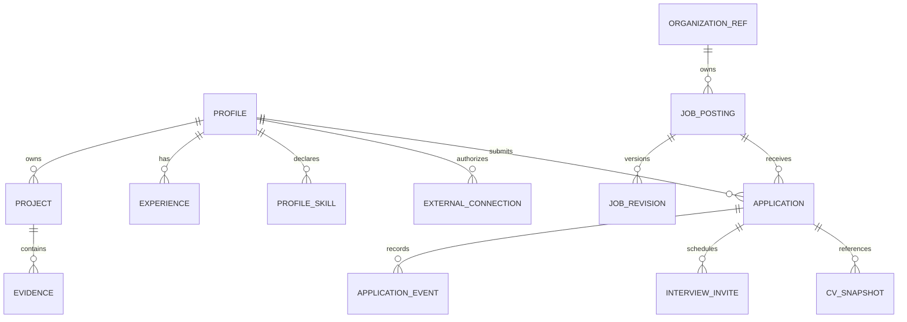

# Meduzellar — Professional Network (LinkedIn + GitHub)
## Master Architecture & Pre-Implementation Finalization v1.0

Ամսաթիվ՝ 2026-11-25 | Staff+ | Evolution-Ready Architecture | Phase A

**Owner Approved — domain planning direction**, օգտատիրոջ ընդհանուր հաստատման հիմքով։ Ստորև նոր մանրամասները նախագծային defaults են այդ լիազորության շրջանակում, ոչ առանձին ստուգված փաստեր կամ անսահմանափակ թույլտվություն։ Platform Phase A բաց է, Phase B NOT AUTHORIZED։ Repository alignment և պաշտոնական ADR դեռ անհրաժեշտ են։

## 0. Պարզ բացատրություն
Մարդը ստեղծում է պրոֆիլ, ցույց է տալիս իր պատրաստած ծրագրերը, կցում է CV և GitHub հղումներ։ Ընկերությունը հրապարակում է աշխատանք, գտնում է մասնագետին, տեսնում է նրա աշխատանքները և հրավիրում հարցազրույցի։ Մասնագետը կարող է վաճառել իր ծրագիրը Marketplace-ում և շփվել Messenger-ի միջոցով իր լեզվով։ Network-ը չի դառնում GitHub-ի կամ LinkedIn-ի պատճեն։ Սեփական Git hosting-ը առաջին թողարկման մաս չէ։

# Մաս I — 12 ճարտարապետական ուղղություններ
## 1. Product & Business Architecture

- Առաջնային լսարան՝ ծրագրավորողներ, freelancers, փոքր software offices, recruiters։ Հայաստանում պահանջարկի վավերացում, միջազգային ընդլայնում ըստ իրավական և գործառնական պատրաստվածության։ Remote, On-site, Freelance աշխատանքներ, նաև hybrid work mode որպես առանձին հատկանիշ։
- Արժեք՝ CV-ից բացի իրական նախագծերի և մասնագիտական ապացույցների ներկայացում։ Ապացույցը չի հավաստում ամբողջական հմտությունը կամ աշխատանքի որակը։
- Անվճար հիմնական պրոֆիլ, աշխատանք որոնել և դիմել։ B2B recruiting tools՝ հիմնական եկամտային վարկած։
- Մեկ human identity, Office-ը առանձին principal է, Membership-ով իրավասությունները՝ shared architecture-ի պայմանագրով։
- North Star՝ Monthly Qualified Hiring Interactions (եզակի դիմում–աշխատատեղ զույգեր, որոնց դեպքում թեկնածուի համաձայնությամբ գործատուն նախաձեռնել է հարցազրույց կամ իմաստալից հաջորդ փուլ)։ Չհաշվել spam կամ կրկնությունները։ Չշփոթել աշխատանքի իրական ընդունման հետ։

| ID | Բիզնես կանոն |
|---|---|
| PN-BR-01 | Մարդը կառավարում է իր պրոֆիլը և տեսանելիությունը։ |
| PN-BR-02 | Office-ը հրապարակում և կառավարում է միայն իրեն պատկանող աշխատատեղերը՝ լիազորված անդամներով։ |
| PN-BR-03 | Դիմելը չի պահանջում վճար կամ GitHub հաշիվ։ |
| PN-BR-04 | GitHub կապակցումը կամ repository ownership-ը չի նշանակում աշխատանքի որակի կամ հեղինակության ամբողջական հավաստում։ |
| PN-BR-05 | Մասնավոր repository-ն չի հրապարակվում լռելյայն։ |
| PN-BR-06 | Դիմումի CV-ն snapshot է՝ սահմանված retention-ով, խմբագրումը չի փոխում նախկին դիմումը։ |
| PN-BR-07 | AI-ն չի կայացնում աշխատանքի ընդունման կամ մերժման վերջնական որոշում։ |
| PN-BR-08 | Marketplace ապրանքը և Messenger conversation-ը պատկանում են համապատասխան դոմենին։ |
| PN-BR-09 | Channel հրապարակումը opt-in է և ենթարկվում է shared quota contract-ին։ |
| PN-BR-10 | Անվտանգությունը, privacy controls-ը և դիմելու հիմնական իրավունքը վճարովի չեն։ |
| PN-BR-11 | Վճարովի promotion-ը տեսանելիորեն նշվում է, չի փոխում ապացույցների հավաստիությունը։ |
| PN-BR-12 | Աշխատանքի կամ պրոֆիլի հեռացումը չի ջնջում օրինական audit/retention պահանջները. տվյալները սահմանափակվում են նպատակով և ժամկետով։ |
| PN-BR-13 | Արտաքին հարթակներից տվյալների ստացումը միայն թույլատրված մեխանիզմներով է, առանց չարտոնված scraping-ի կամ պատճենման։ |
| PN-BR-14 | Աշխատանքի հայտարարությունը չի երաշխավորում աշխատանքի ընդունում. գործատուն պատասխանատու է իր որոշումների համար։ |

## 2. Competitive Intelligence

Ստորև համեմատությունը positioning hypothesis է, ոչ ընթացիկ մրցակիցների գործառույթների ստուգված inventory։ LinkedIn՝ professional identity/recruitment, GitHub՝ code collaboration/evidence, job boards և Victra՝ job discovery/recruitment, portfolio platforms՝ աշխատանքի ներկայացում։ Մեր տարբերակումը՝ մեկ պրոֆիլում թույլատրված project evidence, աշխատանքի դիմում, վաճառքի հղում և բազմալեզու շփում։ Չենթադրել, որ մրցակիցները նման ֆունկցիա չունեն։

Վավերացում՝ 15 թեկնածու և 10 գործատու հարցազրույց որպես նախնական թիրախ, 5 usability sessions յուրաքանչյուր կողմի համար, benchmark նույն առաջադրանքներով (պրոֆիլ, աշխատանք գտնել, թեկնածու գնահատել), willingness-to-pay փորձարկում առանց պարտադիր վճարման։ Գրանցել ամսաթիվ, աղբյուր, պայմաններ, տվյալների հավաքման թույլտվություն։

## 3. Domain Architecture

| Bounded context | Ownership |
|---|---|
| Professional Profile | Profile, Experience, Education, Skill, preferences, visibility |
| Portfolio & Evidence | Project, Evidence, external source linkage, provenance, verification status |
| Organization Presence | Company public page; identity/membership-ը shared է |
| Job Catalog | JobPosting, version, work mode, compensation range, publication |
| Recruitment | Application, candidate snapshot, stage, interview invitation, notes |
| Discovery | Search projection, filters, visibility; ոչ authoritative source |
| Trust & Moderation | Reports, restrictions, employer listing review |
| Social (P1) | Posts, Follow, Connections, Feed |
| AI Assistance (P1+) | Match explanations, CV suggestions, human review; shared AI provider |

### 3.1 Logical model

| Entity | Key constraints |
|---|---|
| Profile | unique human principal; default visibility controlled |
| Project | owner principal, title, description, public/private, source |
| Evidence | source URL, provider ID, observed_at, status, permission, claim type |
| ExternalConnection | provider subject, encrypted credential reference, scopes, revoked_at |
| JobPosting / JobRevision | Office principal, immutable published revision, status, closing time |
| Application | candidate principal, job ID, revision, submitted_at; one active application per candidate/job |
| CVSnapshot | immutable submitted document pointer; limited recruiter access; retention |
| ApplicationEvent | actor, principal, transition, timestamp, reason visibility |
| InterviewInvite | proposed slot/timezone, status, contact consent, external call reference |
| Report / Restriction | reason, scope, decision, appeal, audit |
| OutboxEvent | aggregate version, unique event ID, retry state |

Shared identity references are contracts, not permission to modify shared tables. Financial records remain in Payments; media in Messenger; artifacts for sale in Marketplace. Physical schema and indexes pending shared review. Use UTC timestamps, explicit time zones on interviews, currency code and integer minor units when compensation is recorded, distinguish monthly/hourly/yearly ranges.

### 3.2 State machines
- Job: DRAFT → REVIEW → PUBLISHED → PAUSED/CLOSED/EXPIRED; REJECTED → DRAFT. Security restriction may unpublish any public version. Reopen creates explicit new revision or posting per policy.
- Application: SUBMITTED → IN_REVIEW → INTERVIEW → OFFERED → HIRED; eligible nonterminal states → REJECTED or WITHDRAWN; no hidden stage change by AI. Preserve history, optimistic version checks. Closing a job prevents new applications but does not silently reject existing ones.
- Evidence: SELF_DECLARED → LINKED → SOURCE_CHECKED or FAILED → STALE/REVOKED. Distinguish control of account, observed repository metadata, self-declared authorship, independent assessment. Revocation invalidates source-derived display according to contract.
- Interview: PROPOSED → ACCEPTED/DECLINED/CANCELLED/EXPIRED → COMPLETED; invitation is not accepted without candidate action.

## 4. Functional Architecture

| ID | Requirement / phase |
|---|---|
| PN-FR-01 | P0 create/edit profile, visibility controls |
| PN-FR-02 | P0 experience, education, skills, professional links |
| PN-FR-03 | P0 portfolio projects, images, permitted source links |
| PN-FR-04 | P0 optional GitHub connection and selected public repository metadata; manual link fallback |
| PN-FR-05 | P0 source provenance, freshness, disconnect and removal |
| PN-FR-06 | P0 upload CV, private by default, quarantine and access policy |
| PN-FR-07 | P0 public Office page and delegated recruiter permission |
| PN-FR-08 | P0 create/edit/review/publish/pause/close job |
| PN-FR-09 | P0 job search by skills, work mode, location, compensation when supplied |
| PN-FR-10 | P0 candidate search over explicitly discoverable profiles |
| PN-FR-11 | P0 apply with consent and submitted snapshot |
| PN-FR-12 | P0 application status and withdrawal |
| PN-FR-13 | P0 recruiter pipeline and scoped notes |
| PN-FR-14 | P0 interview invitation, accept/decline, timezone |
| PN-FR-15 | P0 privacy-safe notifications |
| PN-FR-16 | P0 report, block, employer verification and moderation |
| PN-FR-17 | P0 authorized Messenger handoff; native application status remains independent |
| PN-FR-18 | P0 optional Marketplace public product link with visibility checks |
| PN-FR-19 | P1 professional posts, following, connections, feed |
| PN-FR-20 | P1 transparent AI-assisted job recommendations and CV suggestions |
| PN-FR-21 | P1 evidence enrichment, saved searches, recruiter analytics |
| PN-FR-22 | P1 opt-in job projection into professional Channels |
| PN-FR-23 | P2 enterprise recruiting and integrations |
| PN-FR-24 | P2 native Git hosting only after separate feasibility and owner approval |

### 4.1 GitHub integration
Manual links work without OAuth. Optional user-authorized connection uses least privilege; select public repositories explicitly. Verify account link separately from repository contribution. Store only necessary authorized metadata (provider ID, URL, selected title/description, observed timestamp); avoid source code replication, private repositories, collaborator email extraction and token exposure. Credentials encrypted in shared secret mechanism; server-only access; disconnect revokes local access and provider grant when supported. Rate limits, backoff, webhook authenticity if used, cache freshness, deletion propagation, unavailable provider fallback. Do not import LinkedIn data through scraping; allow manual profile/CV input; any future integration requires approved API access and terms review. No external data harvesting. Provider access, allowed fields and retention remain external validation gates.

### 4.2 Recruitment integrity
Server validates job active and candidate consent, creates application and outbox in one transaction, idempotency key plus uniqueness prevents duplicates. Recruiter reads only jobs in authorized Office, notes are not candidate-visible unless explicitly shared. State transition with version guard; user sees accurate status. No automated rejection or covert scoring. Interview consent separate from application; don't expose email/phone automatically. Withdrawal stops further active processing except justified retention; delete/export workflows and audit per policy.

## 5. UX & Customer Journey

| Screen | Primary actions |
|---|---|
| Network Home | Search jobs and professionals, profile completion |
| Profile | Bio, skills, experience, project evidence, privacy |
| Portfolio editor | Select links, source status, preview visibility |
| CV workspace | Upload/replace/delete CV and choose per application |
| Job Search / Details | Filters, job terms, employer status, apply |
| My Applications | Stage, withdraw, interview invitations |
| Office Page | Public organization information |
| Recruiter Dashboard | Job management, authorized applications, interview scheduling |
| Candidate Discovery | Discoverable profile filters, permitted contact requests |
| Trust/Admin | Verification, reports, takedowns, audit |
| Feed/Connections P1 | Publish, follow, hide, report |

Responsive web, shared design system, light/dark, Armenian/English UI default, accessibility keyboard and screen-reader, empty/loading/error and offline retry states. User sees exact visibility before publishing, source checked vs self-declared labels, preview of CV shared, no manipulative defaults. Candidate can use all core flows without external account or Messenger availability. Interview timestamps show local timezone and original zone.

## 6. Trust, Security & Legal

Deny by default, actor/principal and current membership per protected request, object-level checks, tenant isolation, mandatory CORS/CSRF under repo invariants, secure sessions/MFA for privileged roles, rate limiting, encryption transit/at rest, private file storage, quarantine, short-lived authorized downloads, redacted logs, audit sensitive actions. Critical dependency vulnerability stops affected work; no exception. No runtime protections claimed implemented.

| Actor | Public profile | Private CV | Applications | Job management |
|---|---|---|---|---|
| Visitor | public only | no | no | no |
| Candidate | public + own | own | own | no unless authorized Office context |
| Recruiter | discoverable | submitted authorized snapshot | assigned Office/job scope | delegated permission |
| Office owner | same public rules | only authorized recruitment purpose | role-scoped | role-scoped |
| Support/admin | minimum needed | exceptional audited access | restricted purpose | moderation scope |

Threats: IDOR/cross-tenant CV leak; fake jobs, phishing, recruiter spam; OAuth token theft; malicious CV or project links; stale public projections; discriminatory job filters or AI ranking; prompt injection via CV/code; unauthorized contact disclosure; excessive retention; abusive scraping. Mitigate scoped access, URL safety, moderation/report and appeal, human review, allowlisted AI context, untrusted content never instructions, no sensitive traits inference, usage limits, retention controls. Candidate search excludes protected/sensitive traits and private CV by default. AI matching explanations use job-related criteria; opt-out/manual route; assess disparate impact and local law before deployment. Don't use private CVs or messages for model training by default. Legal review: employment discrimination, privacy, data transfer, employer verification, intellectual property and external API terms, retention and deletion, applicable jurisdictions. No claim of legal compliance until reviewed.

## 7. Monetization & Unit Economics

Free: profile, portfolio, job search/apply, privacy controls, basic employer pilot. B2B hypothesis: recruiter workspace subscription, job posting packages, later approved promoted postings (clearly marked), optional AI recruiter tools after validation. Candidate premium optional CV assistance later, never pay-to-apply or guaranteed hire. No production tariff approved. Shared Payments owns subscription and invoice state; Network owns feature eligibility via entitlement contract. Expired plan does not erase applications or access rights mandated by policy.

Contribution per Office = net subscription receipts minus payment fees, AI usage, search/storage, support/moderation and refunds attributable to Office. Track acquisition cost, paid conversion, renewal, job fill outcomes, contribution margin; no assumed profit. Set price via interviews and controlled pilot. Budget caps and per-Office quota before AI activation; reserve usage before request, reconcile measured cost, idempotent usage IDs; failed provider work not charged as successful user action. Quotas and taxes pending external validation.

## 8. Marketing & Growth

Initial niche: Armenian developers and small software offices with international hiring. Founding cohort proposed 30 professionals and 10 Offices; concierge onboarding, portfolio clinics, partnerships with dev communities, opt-in referrals, real verified job supply. No scraping or unsolicited bulk messages. Measure profile completion, projects linked, active real jobs, qualified interactions, applicant response time, hire confirmation (optional), repeat employers and cost per qualified interaction. Pilot gate hypothesis: 10 real active jobs, 20 qualified interactions across at least 5 Offices, zero unresolved critical incidents, feedback from both sides; thresholds to calibrate before pilot. Retention from useful portfolio updates, relevant jobs, and recruitment outcomes rather than addictive feed.

## 9. Ecosystem Integration

| Domain | Contract / failure behavior |
|---|---|
| Identity/Organizations | Current principal, membership, revocation; fail closed for protected operations |
| Marketplace | public product projection with source ID/version; unlist/block invalidates links; no order ownership |
| Messenger | authorized conversation request bound to job/application or profile contact consent; outage leaves application usable |
| Channels | P1 opt-in job projection, shared quota and taxonomy; tombstones prevent stale republish |
| Custom AI | P1 approved context, purpose-bound access, no autonomous hiring decision; outage manual workflow |
| Storage | private CV attachments, scan status, signed access, deletion |
| Payments | Office entitlement and usage; no direct card storage |
| Notifications | minimal payload, deduplication and retry; no CV/contact secrets |

Events proposed: `network.job.published.v1`, `network.job.closed.v1`, `network.application.submitted.v1`, `network.application.stage_changed.v1`, `network.interview.invited.v1`, `network.profile.visibility_changed.v1`, `network.evidence.revoked.v1`. Include event ID, aggregate ID/version, timestamp, principal reference; no CV body/secret. Transactional outbox, idempotent consumer, tombstone, recheck authoritative access before private fetch. Shared event catalog and owner approval pending.

## 10. Technical System Architecture

Candidate modular monolith + isolated workers, shared platform foundation. TypeScript, Next.js/React, NestJS/Express, PostgreSQL/Prisma, REST/OpenAPI, PostgreSQL FTS with structured filters; Redis/BullMQ candidates where shared workload justifies; S3-compatible private storage, Docker, OpenTelemetry, Jest/Playwright candidates. No final versions, no premature Elasticsearch/Kafka/Kubernetes or microservices. Dedicated search only if measured query latency/relevance/volume justify migration with versioned projection and rollback. Separate read search model from write authorization. External provider adapters with timeout, retries, bounded concurrency and circuit breaker. Workers isolate file parsing/scanning; no execution of uploaded project code. Git hosting P2 requires separate design for repository isolation, abuse, storage, backups, IP and costs.

### 10.1 REST draft
| Method/path | Contract |
|---|---|
| GET/PATCH /api/v1/network/me/profile | own profile + version guard |
| GET /api/v1/network/profiles/:id | visibility-filtered |
| POST/PATCH /api/v1/network/projects | own project; ID required for PATCH |
| POST /api/v1/network/integrations/github/connect | authorized connection flow |
| DELETE /api/v1/network/integrations/github | revoke and invalidate |
| POST /api/v1/network/cvs | quarantine upload intent |
| GET /api/v1/network/jobs | paginated/filter search |
| POST /api/v1/network/jobs | authorized Office draft |
| POST /api/v1/network/jobs/:id/publish | review + version guard |
| POST /api/v1/network/jobs/:id/applications | candidate consent, idempotent |
| GET /api/v1/network/me/applications | own only |
| GET /api/v1/network/jobs/:id/applications | recruiter scope |
| POST /api/v1/network/applications/:id/transition | allowed transition, actor + version |
| POST /api/v1/network/applications/:id/interviews | authorized invite |
| POST /api/v1/network/interviews/:id/respond | candidate response |
| POST /api/v1/network/reports | scoped report |

Paths are logical drafts; shared API conventions determine final routing. Cursor pagination, bounded filters, DTO validation, stable error codes, 401/403/404 without enumeration leakage, 409 version/idempotency conflict, 429 rate limit, correlation IDs. No token or CV content in logs. File access check on every issuance; existing signed credentials have limited lifetime and emergency cutoff feasibility gate.

## 11. Quality & Operational Architecture

| ID | Proposed NFR target (not measured) |
|---|---|
| PN-NFR-01 | Read P95 ≤300 ms under agreed pilot load, excluding external provider |
| PN-NFR-02 | Write P95 ≤500 ms excluding asynchronous work |
| PN-NFR-03 | Search P95 ≤500 ms under representative dataset |
| PN-NFR-04 | Availability 99.9% monthly target subject to shared budget |
| PN-NFR-05 | RPO ≤1 hour; RTO ≤4 hours, shared recovery review |
| PN-NFR-06 | Zero unauthorized private CV or tenant access in tests |
| PN-NFR-07 | Zero duplicate active applications under concurrent retries |
| PN-NFR-08 | Zero unresolved Critical dependency vulnerabilities; affected work stops |
| PN-NFR-09 | Visibility revoke authoritative access immediately after committed policy change; projection lag measured, fail closed |
| PN-NFR-10 | AI/external integration outage does not prevent manual core workflow |

| ID | Acceptance test |
|---|---|
| PN-AT-01 | User edits own profile; another user denied |
| PN-AT-02 | Private profile absent from public search |
| PN-AT-03 | Manual portfolio works without GitHub |
| PN-AT-04 | External disconnect invalidates derived access and marks stale data |
| PN-AT-05 | Malicious CV remains quarantined |
| PN-AT-06 | Cross-Office recruiter cannot read CV/application |
| PN-AT-07 | Membership removal denies next protected request |
| PN-AT-08 | Unreviewed job cannot publish via API |
| PN-AT-09 | Closed job rejects new application |
| PN-AT-10 | Parallel retries yield one active application |
| PN-AT-11 | Submitted CV snapshot unchanged by profile edit |
| PN-AT-12 | Invalid or concurrent stage transition rejected |
| PN-AT-13 | Candidate withdraws and active processing stops |
| PN-AT-14 | Interview invitation requires candidate response; correct timezone |
| PN-AT-15 | Messenger/AI outage leaves applications usable |
| PN-AT-16 | Stale publish cannot restore hidden job/profile |
| PN-AT-17 | AI output cannot autonomously reject/hire |
| PN-AT-18 | Report and moderation action audited |
| PN-AT-19 | CORS/CSRF and session revocation tested |
| PN-AT-20 | Backup restore and privacy deletion verified |

Unit, integration with real DB, contract, browser E2E, authorization negative tests, load, dependency/security scanning, restore drill. Metrics: API latency, search lag, application errors, duplicate attempts, moderation backlog, external sync failures, CV scan backlog, quota consumption. Alerts and runbooks for data exposure, fake jobs, provider outage, stale projections, backup failure. Assign operational owners before pilot. No test results asserted.

## 12. Delivery & Staff-Level Documentation

| WP | Work package |
|---|---|
| PN-WP-01 | Phase A repository audit, decision register and shared contracts |
| PN-WP-02 | Threat model, privacy and employer policy |
| PN-WP-03 | Shared foundation after separate Phase B authorization |
| PN-WP-04 | Profile and portfolio vertical slice |
| PN-WP-05 | External link adapter and CV security |
| PN-WP-06 | Office job publication and discovery |
| PN-WP-07 | Candidate application and recruiter pipeline |
| PN-WP-08 | Interviews, notifications, contact permissions |
| PN-WP-09 | Marketplace/Messenger optional handoff |
| PN-WP-10 | Moderation, security, performance, restore and controlled pilot |
| PN-WP-11 | P1 feed, channels, assisted matching after evidence gates |

Each slice: requirements → model → API → UI → tests → review. Phase A approved scope, shared architecture, size, TECH_CARD, 01-ARCHITECTURE, backlog per AGENTS.md. Phase B separate explicit initialization authorization. CI/release/production separate gates. No code/scaffolding/dependencies/migrations under this document. ADR candidates (allocate actual IDs in repo): identity/context; evidence provenance/provider; recruitment state machine; CV privacy; search projection; AI assistance; cross-domain events; monetization. Preserve historical files; no silent changes to other domains.

# Մաս II — 5 Pre-Implementation Finalization փաթեթներ
## F01 — Product Finalization
P0 FR-01–18: profile, projects, optional public GitHub metadata, CV, Office jobs, search, applications, recruiter pipeline, interview invitation, reports, notifications and optional cross-domain handoff. P1 FR-19–22: feed, following, matching, evidence enrichment, channel projections. P2 FR-23–24: enterprise, native Git hosting candidate; no commitment to build hosting. Developers/freelancers/Offices, responsive web, initial Armenia validation, remote international aspirations. Job type and work mode separate. Core flows do not require AI, Marketplace or Messenger.

## F02 — Business & Financial Finalization
B2B-first recruitment subscription hypothesis; free candidate flows, controlled employer pilot; paid posting packages and promotion only after demand and cost evidence. No approved price or quota. Separate Network publishing limits from shared channel quotas. Financial/legal validation before charging. Proposed initial pilot limits (not approved production policy): 10 Offices, 30 candidates, manual moderation; adjust according to workload. Shared infrastructure costs not double-counted with Marketplace/Messenger; estimate compute, DB, storage/egress, scanning, support, moderation, AI separately after hosting quotes. No numeric price claimed.

## F03 — Trust & Ecosystem Finalization
Sections 6 and 9 are binding planning baseline subject to repository security hierarchy. Privacy by default for CV and contact, explicit permission for external data, Office membership revocation, public projection tombstones, no AI hiring automation, no pay-to-apply, separate data owners. Legal retention schedule, country scope, external API terms and employer verification evidence remain open. Security baseline cannot be waived by budget or owner approval.

## F04 — Technical Finalization
Sections 3, 4, 10, 11 establish logical data model, transitions, API/event drafts, reliability and testing. Shared stack candidates only; final runtime/versions, physical schema, provider contracts, OpenAPI schemas, search limits, CV upload size and TTL, retention and performance thresholds require platform review or testing. Provisional technical defaults: private upload max 10 MiB PDF for CV, short-lived download credential max 60 seconds pending cutoff testing, pagination max 50, no public source-code ingestion. Defaults may change with evidence. No executable CV content; validate MIME and actual format in isolated worker.

## F05 — Implementation Readiness
Proposed Network initial delivery scope B, long-term C; platform size C remains shared review. WP-01/02 planning only, WP-03+ require separate Phase B. Initialization blockers: approved platform scope/size, shared Identity/Organizations and domain boundaries, TECH_CARD and architecture, authorized backlog and Phase B. Feature blockers: external GitHub access/terms before integration, CV scanning/privacy before upload, authorized job/recruitment policy before public operation, AI fairness and data validation before matching. Launch blockers: demand, moderation capacity, legal, restore/security/load evidence; payments and provider feasibility before paid launch. Keep native manual path if optional integration unavailable.

# Մաս III — Decision Register

All rows: Owner Approved planning direction by blanket approval; technical defaults conditional; external evidence pending. New material deviations require explicit approval. Repository sign-off still pending.

| ID | Direction | Condition / rationale |
|---|---|---|
| PN-DEC-001 | Professional Network with project evidence | Differentiation hypothesis, validate demand |
| PN-DEC-002 | Developers, freelancers, Offices | Armenia pilot, international readiness |
| PN-DEC-003 | Unified identity + Office context | Shared contract approval |
| PN-DEC-004 | Profile + Portfolio + CV | Private CV, controlled public visibility |
| PN-DEC-005 | Optional authorized GitHub links | Terms/scopes/quality validation, manual fallback |
| PN-DEC-006 | Evidence provenance not automatic skill certification | Separate observed and declared claims |
| PN-DEC-007 | Job posting and discovery | Verified employer/policy readiness |
| PN-DEC-008 | Application pipeline and interview consent | State transitions, scoped access |
| PN-DEC-009 | P1 professional social feed | Evidence-driven expansion |
| PN-DEC-010 | P1 AI-assisted matching, no autonomous hiring | Fairness, consent, legal checks |
| PN-DEC-011 | B2B-first monetization | Pricing and demand validation |
| PN-DEC-012 | Privacy-first, no pay-to-apply | Security invariants mandatory |
| PN-DEC-013 | Independent core + shared domain contracts | Outage isolation |
| PN-DEC-014 | Modular monolith + workers | Shared TECH_CARD pending |
| PN-DEC-015 | PostgreSQL search first | Benchmark before dedicated search |
| PN-DEC-016 | P0 B, future C; native Git hosting deferred | Separate future approval |

## Validation gates
G01 repository alignment; G02 domain approval record; G03 shared contracts and size; G04 TECH_CARD and architecture; G05 Phase B authorization; G06 external integration/legal/AI checks per feature; G07 tests/security/restore/pilot readiness; G08 separately authorized launch/payment. Growth gates: demand, customer value, financial, technical, security/legal, operations, strategic alignment. No bypass of security/legal gates.

# Հավելված A — Shared Platform Dependency Handoff
Identity/Organizations (actor/principal, membership revocation); Payments (Office subscription entitlements, usage); Storage (private CV scan and cutoff); Notifications (minimal events); Messenger (consent-bound contact/interviews); Marketplace (public product link/projection); AI (purpose-limited context, metering, human control); Channels (opt-in publication, taxonomy, quota); Data/infra (ownership, versioned events, search, workers, backups, telemetry). Each shared capability requires owner, versioned contract, failure semantics, delivery phase, security and approval. Compare with Marketplace ADR-009 and Custom Telegram actual repository records; do not assume other sign-off exists. No independent platform-wide decision.

# Հավելված B — Codex workflow
Use accompanying MEDUZELLAR_PROFESSIONAL_NETWORK_CODEX_PROMPTS.md in order: import/audit, alignment, finalization, sign-off, shared handoff. Only explicitly authorized documentation changes; preserve existing uncommitted changes. If source unavailable, stop rather than reconstruct. No implementation authorization.

**End of document — v1.0**
